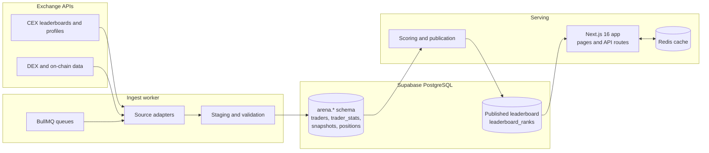

<div align="center">

# Arena

**A crypto trader ranking platform that ingests public leaderboards from centralized and
decentralized exchanges and ranks traders with a unified, risk-adjusted Arena Score.**

[](https://nextjs.org)
[](https://react.dev)
[](https://www.typescriptlang.org)
[](https://supabase.com)
[](https://upstash.com)
[](https://docs.bullmq.io)
[](https://tailwindcss.com)

[arenafi.org](https://www.arenafi.org) · [Architecture](#architecture) · [Arena Score](#arena-score) · [Getting started](#getting-started) · [Documentation](#documentation)

</div>

## Overview

Arena collects public copy-trading and leaderboard data from CEX and DEX venues,
normalizes it into a single schema, and publishes ranked leaderboards for 7-day,
30-day, and 90-day windows. Each trader gets a profile with performance metrics,
equity curves, positions, and risk statistics where the source exposes them.

Beyond rankings, the product includes trader profiles and claims, community groups
and posts, a market overview, an educational library, a Pro membership tier, and
native iOS/Android builds via Capacitor.

> **Release status.** Arena is in a gated pre-release (V1 NO-GO): production
> operations are owner-controlled, and this repository is developed through isolated
> branches and Draft PR review. See [docs/V1_RELEASE_BOUNDARY.md](docs/V1_RELEASE_BOUNDARY.md).

## Highlights

- **Multi-exchange ingest adapters.** 26 registered ingest adapters
  (`lib/ingest/adapters/`) cover 22 venues, including Binance, Bybit, OKX, Bitget,
  Gate, KuCoin, HTX, MEXC, Hyperliquid, GMX, and gTrade. Each adapter declares its
  supported surfaces, captures raw responses through a rate-budgeted fetch session,
  and exposes pure parsers so stored evidence can be replayed offline.
- **Staged, fenced publication.** Raw evidence is validated in staging before
  complete boards are published. Leaderboard generations are claimed, written in
  attested batches, and fenced in SQL so a partial or superseded generation cannot
  replace the serving ranking.
- **Verified scorer.** The Arena Score v4 scorer exists in both TypeScript
  (`lib/utils/arena-score.ts`) and SQL. Both are checked against a shared fixture of
  golden vectors, and the SQL implementation is exercised against a real PostgreSQL 17
  instance.
- **Schema discipline.** 631 timestamped SQL migrations, row-level security
  policies, generated database types, and contract checks that compare code-level
  `.from()` / `.rpc()` dependencies with the database schema.
- **Observability.** Sentry (client, server, edge), structured JSON logging, and a
  `PipelineLogger` that records job duration, status, and record counts.
- **Internationalization.** English, Chinese, Japanese, and Korean, implemented as
  typed message maps with no runtime i18n dependency.
- **Tests.** About 1,400 test files across Jest unit and integration tests,
  `node:test` contract suites, PostgreSQL 17 integration scripts, and Playwright
  end-to-end tests.

## Architecture



- **Ingest** (`worker/src/ingest-worker.ts`, `lib/ingest/`): BullMQ jobs drive
  per-source adapters; raw payloads are captured before parsing, and parsed rows go
  through staging validation and count checks before they reach `arena.*`.
- **Data layer** (`arena.*`): partitioned tables for traders, per-timeframe stats,
  leaderboard snapshots, current positions, and monthly-partitioned history.
- **Scoring and publication**: Arena Score is computed per time-window cohort and
  published into `public.leaderboard_ranks` as a fenced generation. Per-source
  freshness is tracked in `leaderboard_source_freshness.source_as_of`.
- **Application**: Next.js App Router with server components, React Query and
  Zustand on the client, and Upstash Redis for caching and rate limiting.

Detailed data-flow and topology diagrams are in
[docs/ARCHITECTURE.md](docs/ARCHITECTURE.md); the reasoning behind major decisions is
in [docs/DECISIONS.md](docs/DECISIONS.md).

## Arena Score

Arena Score v4 is a 0-100 score computed separately within each window cohort
(7D / 30D / 90D). Every dimension except PnL is a percentile rank inside the cohort:

```
Quality    = weighted mean over the dimensions that are available
               PnL           0.30   log scale, $1K -> 0, $10M -> 1
               ROI           0.20   cohort percentile
               Max drawdown  0.20   cohort percentile (lower is better)
               Sharpe        0.20   cohort percentile
               Consistency   0.10   win rate (0.6) + profit factor (0.4) percentiles

Confidence = 0.35 + 0.65 * cbrt(sample * completeness)
               sample       = trades / (trades + 50)
               completeness = share of risk metrics present (min 0.25)

Composite  = Quality * Confidence
Score      = 100 * (0.7 * percentile(Composite) + 0.3 * Composite / max(Composite))
```

Missing optional dimensions are re-weighted across the available ones rather than
treated as zero, and the confidence term caps small or incomplete samples. The
cross-window composite weights 90D / 30D / 7D at 0.70 / 0.25 / 0.05.

The earlier v3 formula is retained in the same module for comparison:

```
ReturnScore = 60 * tanh(coeff * ROI)^exponent         (0-60)
PnlScore    = 40 * tanh(coeff * ln(1 + PnL / base))   (0-40)
```

## Tech stack

| Layer         | Technology                                           |
| ------------- | ---------------------------------------------------- |
| Framework     | Next.js 16 (App Router), React 19                    |
| Language      | TypeScript (strict)                                  |
| Database      | Supabase: PostgreSQL, Auth, Realtime, RLS            |
| Cache / queue | Upstash Redis, ioredis, BullMQ                       |
| Exchange data | Custom source adapters, CCXT                         |
| Styling       | Tailwind CSS v4 with design tokens                   |
| State         | Zustand, TanStack React Query                        |
| Charts        | TradingView widgets, lightweight-charts              |
| Payments      | Stripe (checkout, subscriptions, webhooks, portal)   |
| Auth          | Supabase Auth, Privy (Web3 wallets)                  |
| Web3          | viem, wagmi, RainbowKit, EAS attestations            |
| Validation    | Zod                                                  |
| Observability | Sentry, structured logging, PipelineLogger           |
| Mobile        | Capacitor (iOS, Android)                             |
| Testing       | Jest, `node:test`, Playwright, PostgreSQL 17 scripts |
| Hosting       | Vercel (app), containerized ingest worker            |

## Repository layout

```
app/                    Next.js App Router pages and API routes
  api/                  Route handlers (public, authenticated, admin, cron)
  components/           Shared UI components
lib/                    Core logic
  ingest/               Adapters, fetch sessions, staging, serving publication
  data/                 Server-side data access
  services/             Business services
  utils/arena-score.ts  Arena Score implementation
  i18n/                 en / zh / ja / ko messages
worker/                 BullMQ ingest worker
supabase/migrations/    PostgreSQL migrations and PG17 integration tests
scripts/                Maintenance, QA, and contract-check scripts
e2e/                    Playwright end-to-end tests
cloudflare-worker/      Cloudflare Worker source
contracts/              Solidity contracts (Foundry)
android/, ios/          Capacitor mobile projects
docs/                   Architecture, decisions, runbooks, audits
```

## Getting started

Requirements: Node.js 22 (see `.nvmrc`) and npm.

```bash
git clone https://github.com/Adeline117/ranking-arena.git
cd ranking-arena
nvm use
npm ci
cp .env.example .env.local   # fill in development values
npm run dev                  # http://localhost:3000
```

Use development or test credentials only. See
[docs/LOCAL_SETUP.md](docs/LOCAL_SETUP.md) and [docs/ONBOARDING.md](docs/ONBOARDING.md)
for details.

## Scripts

| Command              | Description                     |
| -------------------- | ------------------------------- |
| `npm run dev`        | Start the development server    |
| `npm run build`      | Production build                |
| `npm run type-check` | TypeScript check (`tsc`)        |
| `npm run lint`       | ESLint and service-layer checks |
| `npm run test`       | Jest test suite                 |
| `npm run test:e2e`   | Playwright end-to-end tests     |
| `npm run format`     | Prettier                        |

## Testing

```bash
npm run type-check
npm run test                                # Jest
node --test scripts/qa/<name>.test.mjs      # node:test contract suites
npm run test:e2e                            # Playwright
```

Files ending in `.pg17.sh` under `supabase/migrations/__tests__/` start a temporary
local PostgreSQL 17 instance and run migrations and scorer checks against it.

## Operations notes

The following points reflect this source revision; they are documented in full in
[docs/V1_RELEASE_BOUNDARY.md](docs/V1_RELEASE_BOUNDARY.md).

| Area                | Status                                                                                                                                                                                                                                                                         |
| ------------------- | ------------------------------------------------------------------------------------------------------------------------------------------------------------------------------------------------------------------------------------------------------------------------------ |
| Scheduling          | 0 Vercel schedules; the 53 cron/worker route implementations are not scheduled by Vercel                                                                                                                                                                                       |
| Ingest              | 26 registered ingest adapters, loaded by the ingest worker                                                                                                                                                                                                                     |
| Freshness           | Authority is `leaderboard_source_freshness.source_as_of`; `npm run check:freshness` reads it with owner-approved credentials                                                                                                                                                   |
| Legacy backfills    | Retained `backfill-*.ts` entrypoints report `RETIRED` and exit 2                                                                                                                                                                                                               |
| OpenClaw monitoring | Observation only; no auto-fix or release authority during V1 NO-GO                                                                                                                                                                                                             |
| Position history    | `trader_position_history`: Frozen forensic archive; no application reads and never ranking authority                                                                                                                                                                           |
| Referral program    | `V1_REFERRAL_PROGRAM_PUBLISHED=false`: new invitations and rewards are unavailable; existing referral history is not a promise of automatic rewards. This hold is source-only and does not stop, inspect, or prove deployed code, historical records, or external reward state |

## Documentation

| Document                                                     | Contents                                 |
| ------------------------------------------------------------ | ---------------------------------------- |
| [docs/ARCHITECTURE.md](docs/ARCHITECTURE.md)                 | Data flow and infrastructure topology    |
| [docs/DECISIONS.md](docs/DECISIONS.md)                       | Architecture decision records            |
| [docs/ARENA_REBUILD_SPEC.md](docs/ARENA_REBUILD_SPEC.md)     | `arena.*` data-layer specification       |
| [docs/ADAPTER_ONBOARDING.md](docs/ADAPTER_ONBOARDING.md)     | Adding an ingest adapter                 |
| [docs/API_ROUTES.md](docs/API_ROUTES.md)                     | API route reference                      |
| [docs/RELEASE.md](docs/RELEASE.md)                           | Release process                          |
| [docs/SLO.md](docs/SLO.md)                                   | Service-level objectives                 |
| [docs/RUNBOOK.md](docs/RUNBOOK.md)                           | Operational runbook                      |
| [docs/postmortems/](docs/postmortems/)                       | Incident postmortems                     |
| [docs/SOC2_CONTROL_MAPPING.md](docs/SOC2_CONTROL_MAPPING.md) | SOC 2 control mapping                    |
| [docs/DESIGN.md](docs/DESIGN.md)                             | Design system                            |
| [docs/V1_RELEASE_BOUNDARY.md](docs/V1_RELEASE_BOUNDARY.md)   | Pre-release operating boundary and holds |

## Contributing

See [CONTRIBUTING.md](CONTRIBUTING.md). Changes are made on feature branches and
reviewed through pull requests.

## Security

Please report vulnerabilities privately as described in [SECURITY.md](SECURITY.md)
rather than opening a public issue.

## License

All rights reserved. Copyright 2026 Arena. This repository is proprietary; no license
is granted to use, copy, or distribute the code.
