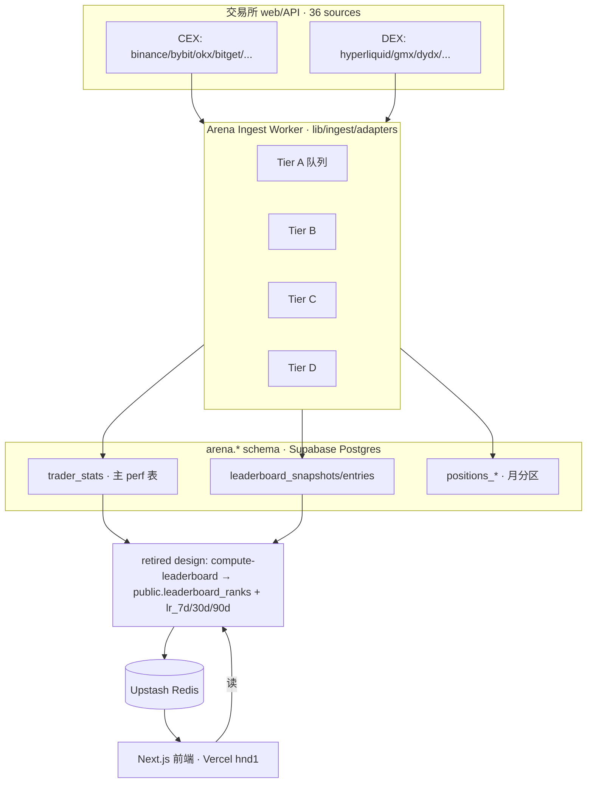
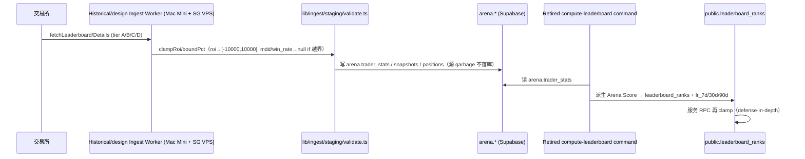
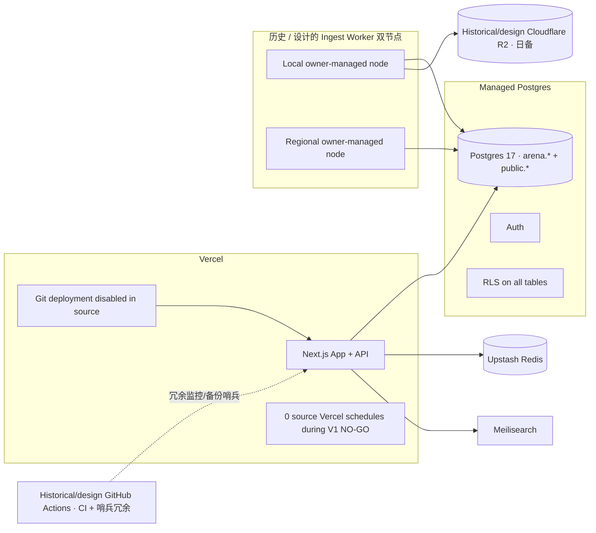

# Arena 架构（数据流 + 拓扑）

> 2026-07-02 首版（Phase 2 知识文档化）。之前审计指出全项目无架构图——本文补上。
> 与 `docs/system-principles.md`（设计原则）、`docs/INGEST_WORKER_TOPOLOGY.md`（worker 节点）、
> `docs/DECISIONS.md`（为什么这么做）配套。数值以 `memory/MEMORY.md` 的实测为准。
> **V1 NO-GO:** these diagrams are source/design context, not live runtime or
> provider-control-plane evidence. They do not authorize a deployment, host access,
> scheduler, queue, credential, proxy, or data operation.
> `V1_CRON_EXECUTION_PUBLISHED=false` and
> `V1_RANKING_COMMAND_CHAIN_PUBLISHED=false` are narrow, checked-in source guards;
> they do not stop or prove the state of an external worker or schedule.
> The former is called directly by 19 route handlers listed below **and** as the
> first statement of `withCron` (`lib/api/with-cron.ts`), so every one of the 25
> `withCron` routes also answers auth-first `401`/`410` (2026-11 correction: an
> earlier wording said it was not a blanket classification of other cron routes).
> `V1_INGEST_EXECUTION_PUBLISHED=false` is a third, separate source guard for the
> checked-in native ingest command path; it is neither a live-host assertion nor a
> blanket classification of legacy queue, proxy, or import paths. The separate legacy
> proxy/import hold, avatar-proxy route (`GET /api/avatar` plus its `/api/v1/avatar`
> rewrite alias), and avatar-backfill handler (canonical `GET
/api/cron/backfill-avatars` plus its `/api/v1/cron/backfill-avatars` rewrite alias),
> together with the separately retired `avatar-mirror` worker, each apply only to their
> explicitly listed handler/entrypoints; none claims every source writer or helper is
> disabled.
> `V1_REFERRAL_PROGRAM_PUBLISHED=false` is a separate browser-safe source hold for
> referral API ingress, presentation, and new referral-link propagation. It leaves a
> V1 status view only and does not prove or alter deployed code, historical records, or
> external reward state.

## 一、系统全景（历史 / 设计语义）

下图描述 intended source architecture，不表示其中的 worker、queue、provider 或 data
flow 正在运行，也不表示任何 cadence 已发布。



## 二、数据管道（历史 / 设计写路径）

该 sequence 仅保留历史/设计的数据依赖关系；它不是 worker、scheduler、queue 或 ranking
publication 的当前执行证明。



**关键约束**：指标净化在 **staging 边界**（`lib/ingest/staging/validate.ts`）——
源返回的 garbage（mdd 140665%、kucoin roi 2.19e9）永不落库；服务 RPC
（`arena_core_modules`/`arena_first_screen`）再 clamp 一次。详见 DECISIONS ADR-004。

## 三、Arena Score 公式

```
ReturnScore = 60 * tanh(coeff * ROI)^exponent        (0-60)
PnlScore    = 40 * tanh(coeff * ln(1 + PnL/base))     (0-40)
Arena Score = (ReturnScore + PnlScore) * confidenceMultiplier * trustWeight
Overall     = 90D×0.70 + 30D×0.25 + 7D×0.05
```

系数随周期变（`lib/utils/arena-score.ts`）。

## 四、基础设施拓扑



**Historical/design gap (see `docs/PHASE2_INFRA_PLAN.md`):** older designs assigned
collection, backup, and monitoring responsibilities to local and regional nodes.
This does not prove that any node, proxy, worker, or GitHub monitor is running; V1
does not authorize starting, accessing, or restoring one.

## 五、发布与质量门禁 — V1 NO-GO

没有启用的发布流。已检查入库的 Vercel 配置禁用 Git 触发部署并声明零个 Vercel
schedules；这只是源码候选，不证明或改变任何已部署 provider、worker、Redis、QStash
或数据库调度状态。不得用 Git push、CI、Vercel CLI、Preview、dashboard、cron、smoke
或 rollback 作为替代路径。

在已记录的 ranking-command chain 中，`V1_CRON_EXECUTION_PUBLISHED=false` 让
`/api/cron/compute-leaderboard`、`/api/cron/precompute-composite`、
`/api/cron/sync-meilisearch`、`/api/cron/pipeline-evaluate` 和
`/api/hooks/post-deploy` 在 auth-first 之后固定返回 401/410 与三层 `no-store`，且不进入
参数、锁、pipeline log、cache、data 或 provider 工作。本段不概括其他 cron。独立的
`V1_RANKING_COMMAND_CHAIN_PUBLISHED=false` 让源码中的 legacy downstream
worker/scheduler/caller chain 在 dotenv、DB、Redis、BullMQ 或 HTTP 工作前退出/返回。
两者都不能停止已运行的 process 或 checkout 外已有的 schedule。

同一个固定、非环境的 `V1_CRON_EXECUTION_PUBLISHED=false` source gate 还单独封存精确十个
direct service-auth cron ingress handler：`GET /api/cron/batch-5min`、`GET
/api/cron/check-data-freshness`、`GET /api/cron/cleanup-data`、`GET
/api/cron/cleanup-stuck-logs`、`GET /api/cron/detect-contracts`、`GET`/`POST
/api/cron/fetch-funding-rates`、`GET`/`POST /api/cron/fetch-market-data`、`GET`/`POST
/api/cron/fetch-open-interest`、`GET /api/cron/qualify-referrals` 与 `GET
/api/cron/smoke-test`。每一入口均 auth-first：缺失或无效 service authentication 返回 `401`；
valid service secret 固定返回 `410 CRON_EXECUTION_NOT_PUBLISHED`。两条路径均带
`Cache-Control`、`CDN-Cache-Control`、`Vercel-CDN-Cache-Control` 三层 `no-store`，且在
query/body 解析、lock、`PipelineLogger`、database、cache、provider 或 network 工作前结束。
这只是 source-only boundary，不能停止、检查或证明已部署的 scheduler、host、queue 或 worker。

**2026-11 纠偏（数量）**：上文"十个入口""不概括其他 cron"不完整。同一 gate 还是
`withCron`（`lib/api/with-cron.ts`）的第一条语句，因此 25 个 `withCron` 路由在有效密钥下同样
固定 `410`；直接调用 gate 的路由共 19 个（含上述十个、ranking-command chain 四个、
`batch-discover`、`backfill-avatars`、`/api/hooks/post-deploy`、`/api/health/heartbeat`、
`/api/health/evaluate-report`）。另有若干自定义 `401`/`410` 墓碑（如 `compute-derived-metrics`、
`retry-dead-letters`、`ensure-partitions`）。`vercel.json` 没有 `crons`，所以即使把该常量改为
true，这些路由也没有任何调度者；恢复计划必须同时定义调度来源。唯一独立于该 gate 运行的监控是
`.github/workflows/public-freshness-probe.yml`（只读公开 `/api/health`）。

独立的 `V1_INGEST_EXECUTION_PUBLISHED=false` 让已登记的 native ingest worker entry 在
dotenv/runtime dependency 初始化前退出，scheduler/connection 在 DB、ioredis 或 BullMQ
工作前结束，Tier-C 与 first-party bridge 不接纳新 ingest，受覆盖的 direct ingest script 也
不启动工作。`POST /api/trader/onchain-enrich` 固定返回 `410
INGEST_EXECUTION_NOT_PUBLISHED` 及三层 `no-store`，先于 body、rate limit、provider 或
serving-data 操作。`/api/traders/[handle]/core` 与 `/records` 保留 warm serving read；需要
Tier-C 的分支以 pending 降级，不初始化 provider/ioredis/BullMQ bridge 或读取 result queue。
两条 public route 的普通 rate limit 仍可能读 Redis，这一源码门禁并不声称它们没有 Redis
读取。该门禁不能停止或证明 host/queue/external schedule。
已登记的 legacy-refresh source boundary（含 client-safe 固定 false 的
`V1_LEGACY_REFRESH_JOBS_PUBLISHED` marker）已单独封存 legacy `refresh_jobs`：
`batch-discover` 为 auth-first `401/410` tombstone，`batch-5min` 由上方精确列出的 direct
service-auth cron ingress boundary 单独封存，
public trader refresh 不再接纳 job，legacy detail 固定 `refresh_job: null`。它不涵盖
legacy proxy/import path；后者由下面独立且范围有限的审查封存。

本次单独的 legacy proxy/import source hold 现在只涵盖以下历史入口：
`GET /api/proxy/phemex`、`cloudflare-worker/src/index.ts`、
`scripts/import/import_all_platforms.mjs`、`scripts/import/refresh.sh`、
`scripts/import/import-all-blocked.sh`、`scripts/import/run_hl_enrichment.sh`、
`scripts/vps-deploy/scraper-v16-parallel.js`、`scripts/vps-deploy/arena-proxy.mjs`、
`scripts/archive/test-vps-scrapers.ts` 和
`scripts/archive/verify-data-accuracy.mjs`。Phemex route 保持 auth-first：无效认证 `401`，
有效认证 `410 LEGACY_PROXY_ACQUISITION_NOT_PUBLISHED`，两条路径均有三层 `no-store`，并在
URL/query、upstream fetch 或 logging 前结束。checked-in Cloudflare Worker 对任意请求固定
`410 LEGACY_PROXY_IMPORT_NOT_PUBLISHED` 与三层 `no-store`、不 fetch；列出的脚本均在 proxy、
browser、import 或 host 工作前报告 `RETIRED` 并 exit `2`。这些代码门禁不停止、不检查也不证明
任何已部署 CF Worker、VPS proxy/scraper、host process、queue 或 external schedule。它们不涉及
单独封存的 worker `avatar-mirror` 或下方单独封存的 avatar-proxy route；其他 avatar-related API
path/helper、UI/read RPC、adapter 与未列 writer 没有在本 PR 中被关闭或重新分类。

独立的 V1 avatar-proxy source hold 覆盖匿名 `GET /api/avatar` 及其
`/api/v1/avatar` rewrite alias：两条路径解析到同一固定 `410` response，并带
`Cache-Control`、`CDN-Cache-Control`、`Vercel-CDN-Cache-Control` 三层 `no-store`，在 query
解析、DNS lookup、upstream fetch 或 logging 前结束。matching proxy bypass 仅保持该匿名
no-store response contract，并非 upstream-proxy permission。已登记 helper 和已知 UI/OG consumer
不再生成 proxy request；需要 proxy 的 origin 没有 mirror 时使用 local、inline 或 default fallback。
这不表示所有 avatar browser/network request 为零：existing Supabase mirror 与 direct allowed
raw-avatar URL 仍可能 render，其他 avatar-related API path/helper、adapter 与未列 writer 不在此
boundary 内。该 source-only change 不能清除旧 CDN cache、停止 older deployed code，或证明
external state。

独立的 canonical `GET /api/cron/backfill-avatars` 及其
`/api/v1/cron/backfill-avatars` rewrite alias 解析到同一 source-only tombstone handler：先校验
service authentication，缺失或无效认证返回 `401`；有效认证返回 `410
CRON_EXECUTION_NOT_PUBLISHED`。两条路径均有三层 `no-store`，并在参数解析、数据库、logging 或
upstream fetch 前结束。该源码契约同样不停止、不检查也不证明已部署 host、external scheduler 或
healthcheck；该 handler 不涵盖单独的 avatar-proxy route、其他 avatar-related API path/helper、
UI/read RPC、adapter 或未列 writer，且单独的 worker `avatar-mirror` source hold 不扩大其范围。

独立的 checked-in `avatar-mirror` worker execution 已 source-only retired：processor 为 no-op，
scheduler 不再生产 avatar-mirror job；legacy queued avatar-mirror job 在 `route()` 内以 no-op 返回，
早于该 handler 调用 `getConnection()`、获取 per-job source lease 或加载 processor。这不声称外围
worker 或 BullMQ 尚未建立或使用 shared Redis，或尚未获取 job lock。这不停止、不检查也不证明已运行
worker、Redis、host process 或 schedule 已停止；它不扩大单独的 avatar-proxy boundary，也不涵盖
其他 avatar-related API path/helper、UI/read RPC、adapter 或未列 writer。

未来的发布流程必须由 owner 重新定义并单独批准：精确 candidate SHA、隔离目标、受保护
source/reviewer 边界、数据库兼容性、只读证据、可逆失败边界和保留的审计材料。具体操作
步骤不在本文档中；参见 `docs/RUNBOOK.md` 的 owner escalation boundary。

## 六、关键文件索引

| 层                 | 位置                                                                                    |
| ------------------ | --------------------------------------------------------------------------------------- |
| Ingest adapters    | `lib/ingest/adapters/<source>/`（NOT lib/connectors）                                   |
| Ingest worker 入口 | `worker/src/ingest-worker.ts`（V1 固定 source hold；不启动 native ingest，非运行证明）  |
| 指标净化           | `lib/ingest/staging/validate.ts` + `lib/pipeline/validate-before-write.ts`              |
| 主 perf 表         | `arena.trader_stats`（trader_latest/v2 已 DROP 2026-06-16）                             |
| 服务层             | `public.leaderboard_ranks` + `lr_7d/30d/90d`                                            |
| Arena Score        | `lib/utils/arena-score.ts`                                                              |
| 缓存预设           | `lib/hooks/cache-presets.ts`                                                            |
| Auth 原语          | `lib/api/with-cron.ts`/`with-admin-auth.ts`/`auth.ts`/`lib/auth/`                       |
| 数据获取           | Server `lib/data/*`；Client `lib/hooks/use*`（React Query）；Cache `lib/cache/redis.ts` |

## 七、运行时源码边界

`app/`、`lib/`、`worker/` 与已登记的根运行时入口构成生产源码来源。仓库内 import
解析完成后，目标必须位于 `app/`、`lib/` 或 `worker/`，并继续遵守 UI、共享库和 worker
之间的既有单向依赖规则。根运行时入口只可额外引用其他已登记的根运行时入口。

`tooling/`、`infra/`、`cloudflare-worker/`、`e2e/`、根 `__tests__/` 以及其他部署外或
独立部署根不得进入上述运行时依赖图；静态 import、dynamic import、re-export、require
与 type-only import 使用同一规则。第三方 bare package import 不属于仓库目标，不受此根
分类影响。该约束由 `npm run qa:architecture` 强制执行。

## 八、安全横切基建

除全表 RLS（Supabase policies）外，安全原语分布如下（`middleware.ts` 级 CSP/CORS
在 `middleware.ts` 之外由 Next 配置 + 各 API wrapper 承担）：

| 措施         | 实现                | 位置                          |
| ------------ | ------------------- | ----------------------------- |
| XSS 消毒     | DOMPurify           | `lib/utils/sanitize.ts`       |
| 限流         | Upstash Ratelimit   | `lib/utils/rate-limit.ts`     |
| API key 加密 | AES-256-GCM（静态） | `lib/exchange/encryption.ts`  |
| 行级安全     | RLS                 | Supabase policies（全表启用） |

API 鉴权默认拒绝兜底见 DECISIONS ADR-012；`qa:api-auth` CI 门禁强制每 route 有
auth 原语或登记公开白名单。
