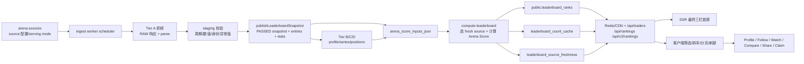

# ArenaFi 全量上线审计与用户路径 — 2026-07-18，滚动更新至 2026-08-08

> 范围：B2C 交易员发现、排行榜、关注/收藏/对比、认领、个人主页、社交、
> Onboarding、Pro 转化与核心市场页。本文区分“代码已修”“数据库已迁移”
> “生产已部署”“需要 owner”的状态，任何一层没完成都不写成已上线。

## 2026-08-08 当前结论（覆盖下文历史状态与数字）

本节是当前 release candidate 的唯一状态入口。下文保留 2026-07-18 的详细流程、
历史问题和设计证据，但凡状态、数量或生产健康结论与本节冲突，以本节为准。

### 当前上线判定

- **代码侧已知 P0 正在逐域清零**：账户、认证、资金权益、排行榜发布、私聊、
  收藏夹、通知和帖子写入已完成新一轮原子性/完整性审计；每个小修复独立测试、提交，
  分支只在工作树清洁且定向测试通过后走安全推送门禁。
- **整体 P0 尚未清零，禁止宣布正式上线**：生产数据库本轮出现 Cloudflare 522，
  runner 中的 199 条 predeploy 与 17 条 postdeploy 尚未在健康生产库做
  exact-ledger 证明；1090 更必须等原子流量切换完成且
  `old_instances_remaining=0` 后才能执行；CopyTrading v1
  cap、凭据轮换和 Stripe live readiness 仍需要 owner 操作。
- 免费、只读页面即使能降级渲染，也不能用来证明写入、收费或数据 freshness 健康。
- 当前候选分支为 `codex/api-tier-cancel-identity-20260729`；只有部署平台返回的精确
  release SHA 与最终候选一致，才进入生产浏览器验收。

### P0 — 致命：当前完整清单

| ID    | 问题/风险                                                                                              | 已完成的代码处置                                                                                                                                                                       | 上线状态                                                                                                                         |
| ----- | ------------------------------------------------------------------------------------------------------ | -------------------------------------------------------------------------------------------------------------------------------------------------------------------------------------- | -------------------------------------------------------------------------------------------------------------------------------- |
| P0-01 | CopyTrading v1 可绕过网页直调，旧合约缺少足够资金安全边界。                                            | 网页、地址与产品入口永久 fail-closed；保留隔离 runbook。                                                                                                                               | 👤 owner 仍须把 `maxFollowersPerTrader` 从实时 getter 的 `100` 改为 `0`。                                                        |
| P0-02 | 生产数据库不可达时，榜单水位、写入和迁移状态都无法证明；本轮 build/页面请求观察到 Cloudflare 522。     | sitemap/build 和只读页面在 authority 故障时诚实降级，不伪造数据。                                                                                                                      | 👤 恢复数据库后重跑 exact ledger、schema/type、health 和同 SHA 浏览器验收。                                                      |
| P0-03 | 数据库密码以及 Alchemy/Brave 凭据曾进入受控诊断输出。                                                  | 代码和文档不复述值，后续诊断不打印继承环境。                                                                                                                                           | 👤 轮换、更新所有运行环境并撤销旧值。                                                                                            |
| P0-04 | Stripe live 可能存在订阅投影漂移、旧 writer、重复购买或错误撤权。                                      | checkout、webhook、退款、争议、entitlement、账户删除结算均 fail-closed；成功页只接受绑定当前 viewer/session 的 exact checkout/entitlement authority；真实收费继续关闭。                | ✅ `9bd89c219` / `a78c1e707` 定向回归；👤 readiness 清零、旧 writer 撤权、test/live canary 全过后才能开收费。                    |
| P0-05 | Stripe Portal/Checkout 成功响应若携带恶意 URL，浏览器可能被导向第三方。                                | Portal 只信任规范 `https://billing.stripe.com`；Checkout 只信任规范 `https://checkout.stripe.com`，拒绝凭据、自定义端口、伪子域、空白和 HTTP。                                         | ✅ 代码、前后端双层校验与回归测试已推送；⏳待部署。                                                                              |
| P0-06 | 账户删除可能先删 auth、后结算失败，或在重试/恢复时产生重复资金动作、复活已删除主体。                   | 删除 intent、一次性 settlement barrier、billing recovery、auth invalidation、hard-delete recovery 全部持久化并串行化；OTP-only 用户不再被不存在的密码卡死。                            | ✅ 代码/PG17；⏳迁移与生产恢复演练。                                                                                             |
| P0-07 | 旧 JWT、封禁/删除用户、SIWE/WebAuthn/2FA 并发可能继续写库或重放凭据。                                  | 请求 admission、数据库 mutation barrier、SIWE nonce/wallet、WebAuthn assertion/counter/credential、2FA 都绑定 active profile 与原子 authority。                                        | ✅ 代码/PG17；⏳迁移与生产认证 E2E。                                                                                             |
| P0-08 | 交易所 OAuth/API key、portfolio、trader claim/primary link 与账户删除并发时可能残留凭据或错误 owner。  | OAuth state 原子 claim；refresh 串行；credential、portfolio、claim、primary trader 绑定账户生命周期；connect/list/sync/disconnect 只信任完整且绑定 viewer/exchange/generation 的回执。 | ✅ `7516d39ea` / `ec54092a9` / `dd784a481` / `1470d448a` 定向回归；⏳迁移与真实只读连接 canary。                                 |
| P0-09 | 私聊列表、搜索、会话创建/读取/设置、reaction 和附件若分步查询，可能越权、泄露私有媒体或返回撕裂快照。  | service-only 原子 RPC；附件 bucket 私有化并在每次读取重签名；删除内容不再读出；actor/recipient 生命周期同快照复核。                                                                    | ✅ 代码/PG17；⏳迁移与双账号 E2E。                                                                                               |
| P0-10 | Watchlist/Favorites 分步 mutation/read 会出现 UI 假成功、订阅漂移、私密 folder/post 泄露或跨用户误写。 | mutation、subscription、folder lifecycle、四类 read snapshot 均原子化；API 使用 verified bearer user client 调 authenticated RPC；完整性不足 fail-closed。                             | ✅ 代码/PG17；⏳迁移与双账号 E2E。                                                                                               |
| P0-11 | 通知过滤后分页、mark-read/delete/create 和排名批量通知分步执行，会漏项、重复、串用户或误发 push。      | 原子 filtered page/mutation/create/batch authority；稳定 event identity 去重；500 分片、逐条 ACK 绑定，只对 `CREATED` 发 push。                                                        | ✅ 代码/PG17；⏳迁移与通知/推送 E2E。                                                                                            |
| P0-12 | leaderboard 直接 writer、零行成功、过期 edge cache 或不完整来源可把错误排名发布给所有用户。            | publication fence、typed batch receipt、sealed rankings/source freshness、零行/部分写 fail-closed、旧 writer 关闭、last-good 保留。                                                    | ✅ 代码/PG17；⏳生产数据链和 release SHA 实证。                                                                                  |
| P0-13 | API key 创建/列出/撤销若相信残缺响应，会泄露完整 secret、展示错套餐额度或把失败当成功。                | 创建、列表、撤销均验证 exact ACK；列表验证 owner/tier/limit/usage/time 并脱敏；一次性 secret 在后续刷新失败时仍保留给用户。                                                            | ✅ 代码与前端回归；⏳部署后真实 key canary。                                                                                     |
| P0-14 | 新应用依赖的数据库 authority 未进入 launch runner，会在部署后让核心功能整体不可用。                    | 1070 desired-state、1080 causal intent、1100 post media registry 与 1090 legacy closure 已分别进入精确、有序、唯一的 pre/postdeploy manifest；body/hash/ledger 与外层事务门禁保留。    | ✅ `e1ba49111` / `6bac3ace0` / `b8dc3e1cb` / `d44e72822`：199 predeploy / 17 postdeploy / 226 唯一成员，Node 19/19；⏳生产执行。 |
| P0-15 | 四个 hot-score SECURITY DEFINER RPC 保留 PUBLIC EXECUTE，外部可重算帖子排序。                          | `20260803104500` 绑定安全 config/source comment，并只允许 `service_role` EXECUTE。                                                                                                     | ✅代码/PG17；⏳生产 migration 与只读 attestation。                                                                               |

P0 的“代码已修”不等于“生产已清零”。P0-01 至 P0-04 的 owner/基础设施动作、
P0-02/P0-06 至 P0-15 的生产迁移与同 SHA 验收全部完成前，发布结论保持 **NO-GO**。

### P1 — 重要：当前清单

| ID    | 问题                                                                                                                                                                  | 当前处置                                                                                                                                                                                                                                                                                                                                                                                                                                                                                                                                                                                                                                               |
| ----- | --------------------------------------------------------------------------------------------------------------------------------------------------------------------- | ------------------------------------------------------------------------------------------------------------------------------------------------------------------------------------------------------------------------------------------------------------------------------------------------------------------------------------------------------------------------------------------------------------------------------------------------------------------------------------------------------------------------------------------------------------------------------------------------------------------------------------------------------ |
| P1-01 | 首页慢加载时先单列、后变标准 UI，造成明显 CLS。                                                                                                                       | 根因是 `responsive.css` 被 `media=print` 延迟；`ac02397a8` 改为首绘前加载，`5c7bbfb74` 再纳入 Next 内容哈希编译图，18 个相关测试与 webpack 产物顺序均通过。✅代码；⏳正式域仍是旧 SHA `de5524bd…` 且仍输出旧延迟脚本，部署 exact SHA 并完成慢网复验前不得清门。                                                                                                                                                                                                                                                                                                                                                                                        |
| P1-02 | Token rankings 在后端不可用时把 popular tokens 整页打成 500。                                                                                                         | last-good/degraded/503 truth；不再让附属模块拖垮主页面。✅                                                                                                                                                                                                                                                                                                                                                                                                                                                                                                                                                                                             |
| P1-03 | 90D/30D/7D 在请求进行中被禁用，旧请求阻塞下一次点击。                                                                                                                 | 周期按钮始终可操作，切换会 abort 旧请求；补 `aria-pressed`、`aria-busy`；满足 WCAG 2.2 的 24px 最低目标，核心移动动作使用 44px 级目标。✅                                                                                                                                                                                                                                                                                                                                                                                                                                                                                                              |
| P1-04 | Inbox/filter 先分页后过滤会出现空洞；通知 panel loading/empty/error 混淆。                                                                                            | 服务端过滤后原子分页；panel 状态和交互对齐。✅                                                                                                                                                                                                                                                                                                                                                                                                                                                                                                                                                                                                         |
| P1-05 | Favorites/Following/Portfolio/Compare/Claim 请求失败时伪装为空或清掉 last-good。                                                                                      | 各域保留 last-good，显式 error/retry；服务端确认前不做不可逆 UI 删除。✅                                                                                                                                                                                                                                                                                                                                                                                                                                                                                                                                                                               |
| P1-06 | Settings 的 passkey、block、session、profile image 操作可能静默失败或乐观显示成功。                                                                                   | list/mutation exact ACK；删除 passkey/unblock/session revoke/profile image 保存均有真错误与回滚。✅                                                                                                                                                                                                                                                                                                                                                                                                                                                                                                                                                    |
| P1-07 | build 依赖生产数据库生成动态 sitemap，数据库故障可阻塞整个 release。                                                                                                  | build phase 只保留静态 sitemap；运行时动态 shard 故障返回空 shard。✅ production build 已在 522 条件下成功。                                                                                                                                                                                                                                                                                                                                                                                                                                                                                                                                           |
| P1-08 | 其余页面仍需逐页截图复核重叠、safe-area、触控目标、焦点、对比度和错误态。                                                                                             | 🔄 按公开主流程优先继续；排行榜日文 320/375px 工具栏裁切已修并留几何/截图证据，其余页面继续。                                                                                                                                                                                                                                                                                                                                                                                                                                                                                                                                                          |
| P1-09 | 认证写流程缺少完整生产双账号/OTP/passkey/Stripe test fixture E2E。                                                                                                    | 🧪 单元、合同、PG17 已覆盖；⏳健康 staging/production fixture 后补浏览器闭环。                                                                                                                                                                                                                                                                                                                                                                                                                                                                                                                                                                         |
| P1-10 | 帖子编辑分步更新正文、语言、提及、标签和计数，可能部分成功或覆盖并发版本。                                                                                            | 10 参数原子 CAS RPC 同步全部 facet/join/count；保留旧签名滚动兼容，应用全量后再按 `186000 → 187000` 关闭旧签名。✅代码/PG17；⏳生产迁移。                                                                                                                                                                                                                                                                                                                                                                                                                                                                                                              |
| P1-11 | 媒体上传客户端信任 URL-only/跨 owner 回执，编辑鉴权失败会无限骨架，预览控制与正式渲染不一致。                                                                         | 图片/视频回执绑定 owner/path/origin/MIME/size；编辑页失败退出 loading、补 mention picker，预览拒绝危险图片并精确移动/删除。✅                                                                                                                                                                                                                                                                                                                                                                                                                                                                                                                          |
| P1-12 | 上传后取消/失败、编辑移除或删帖会遗留 `posts` Storage 对象；直接查引用后删除又会产生并发数据丢失。                                                                    | `05adf3ef3` / `b8dc3e1cb` 建立并调度 private、service-only 1100 registry；`a7e493e4c` 让 dedicated image/video 严格执行 reserve→Storage exact ack/list→finalize，提交/响应不确定时保留 tracked object，仅明确 DB rollback 才精确清理；`05afdf4b1` 分类 post/group-avatar purpose，`468154b00` 补头像 CSRF，`e718f8477` 关闭 generic `/api/upload` 的 `posts` 绕过；`d24d69a15` 再绑定唯一 listing 的 object id、MIME、size 与可选 content length。当前没有 claim/cleanup admission/lease/lifecycle delete/cron/GC，`gc_admitted_at` 仍强制为 `NULL`，所以媒体已知 P0=0；但历史 legacy quarantine、原子 claim 与回收闭环未完成，P1 仍开放且发布 NO-GO。 |
| P1-13 | 路由 loading shell 重复预留已存在的导航高度，转场时出现布局 flash。                                                                                                   | `e3feea06a` 移除重复 nav spacer，并用 shell 几何合同覆盖 route-group 与 page skeleton。✅                                                                                                                                                                                                                                                                                                                                                                                                                                                                                                                                                              |
| P1-14 | 付款成功页可能将验证中、成功与未确认混为一种界面，或在小屏/键盘下丢失下一步。                                                                                         | `9bd89c219` 锁定 exact authority；`a78c1e707` 分离 verifying/success/error、补 retry/焦点/ARIA、320px 几何与 ≥48px 控件。✅                                                                                                                                                                                                                                                                                                                                                                                                                                                                                                                            |
| P1-15 | Groups 管理的解散、广播、邀请、批量成员动作和 Load more 可被双击、旧 scope 或不稳定 cursor 破坏。                                                                     | `e261d20dc` / `3725000b` / `b637fc1a` / `982d33130` 补不可逆锁、single-flight/exact ACK、按选择顺序串行批处理和稳定去重分页。✅                                                                                                                                                                                                                                                                                                                                                                                                                                                                                                                        |
| P1-16 | 点赞/点踩只相信宽松 2xx，重放 toggle 会反转已提交状态，旧 viewer、慢补水或迟到 ACK 还会覆盖最新点击。                                                                 | 新 desired-state RPC 以绝对 `up/down/null` 收敛；四类客户端统一 exact actor/post/request/desired receipt、同 ID 有界重放、latest-intent queue、scope/hydration revision 和“不确定不反向回滚”。✅代码/PG17；⏳生产迁移。                                                                                                                                                                                                                                                                                                                                                                                                                                |
| P1-17 | 邀请奖励 UI 可能把资格数当已授权权益、跨标签页重复创建邀请码，或把 pending/revoked 显示成已解锁。                                                                     | `d561dc612` 以 qualification + entitlement grant 为服务端真值；`66cfb27a6` 对 409 做 GET 对账、区分全部奖励状态，只有 active 显示 unlocked。✅；生产 cron/migration 仍待验证。                                                                                                                                                                                                                                                                                                                                                                                                                                                                         |
| P1-18 | 视觉/按钮巡检的动态样本请求没有稳定 User-Agent，可能被 API 代理拒绝而漏掉真实 trader/post/profile。                                                                   | `2069f462c` 让 public sweep sampler 显式标识自己，并以合同测试锁定；样本 API 不健康时仍明确 skip，不使用退休 fixture。✅                                                                                                                                                                                                                                                                                                                                                                                                                                                                                                                               |
| P1-19 | 评论点赞/点踩可接受错 actor/post/comment、额外字段或非 JSON 的宽松 2xx；悬挂、重放 toggle 与迟到意图会留下假状态。                                                    | `3dcf3b38d` / `e1ba49111` 发布 desired-state；`8f05b95ec` / `c50ab2911` / `209661569` / `d6bad1ef2` / `92d0c926e` 再以服务端 reservation ticket、exact causal apply、跨标签预留串行、有界清理与 DB head/operation ledger 栏住迟到申请；`d874d8ad9` / `fd9172450` 锁死旧入口与已审摘要。保证仅是 **DB reservation-order**，不是不可观测的 physical click order。✅应用 7 suites / 263 tests；✅1080/1090 static 20 + 两套 PG17 + TypeScript；⏳原子切流、生产迁移与 E2E。                                                                                                                                                                               |
| P1-20 | Activity Feed 首次加载时列表完全空白，但 freshness 标题误报 `Live`，用户无法区分加载与无数据。                                                                        | `5fed64896` 把标题改为 Loading，列表预留 128px 可见 loading status，补 `aria-live` / `aria-busy`；375px 回归截图无重叠。✅                                                                                                                                                                                                                                                                                                                                                                                                                                                                                                                             |
| P1-21 | Token 排名索引的 transport/body 可悬挂，失败、真空和旧结果混在一起。                                                                                                  | `6ca74b703` 给 fetch 与 JSON 共用 15 秒物理截止，严格校验响应与当前查询 scope，分离 loading/last-good/error/empty，并补可重试与 44px 控件。✅                                                                                                                                                                                                                                                                                                                                                                                                                                                                                                          |
| P1-22 | Weekly 排名服务端等待无界，authority 故障时整页可能长期 skeleton。                                                                                                    | `0a309e690` 给服务端读取和页面外层都加有界截止，只有完整合法周榜可替换 last-good；部分、错误与真空不再互相伪装。✅                                                                                                                                                                                                                                                                                                                                                                                                                                                                                                                                     |
| P1-23 | 全局 Search 接受宽松结果，旧关键词/迟到响应或畸形 2xx 可覆盖当前页面。                                                                                                | `1006d4e66` 绑定规范查询、分页与四类结果，fetch/JSON 同一物理截止；查询 generation 隔离，保留同 scope last-good，并明确 error/retry/empty。✅                                                                                                                                                                                                                                                                                                                                                                                                                                                                                                          |
| P1-24 | Exchange leaderboard 的 RPC 或页面请求可悬挂，金额/来源/周期形状不足时仍可能发布。                                                                                    | `ee05be684` 加 RPC 3.5 秒与页面 4 秒双层真实截止，严格 timeframe/source/row/money schema，分离 partial/last-good/error/empty，并使用稳定 loading shell。✅                                                                                                                                                                                                                                                                                                                                                                                                                                                                                             |
| P1-25 | 共用 HTTP helper 只触发 AbortSignal，transport 或 `response.json()` 忽略 signal 时仍会永久等待。                                                                      | `4764a4156` 把物理 deadline 覆盖到 fetch 与 body 消费，并传播调用方取消；迟到工作被观察但不可再落入 UI。✅                                                                                                                                                                                                                                                                                                                                                                                                                                                                                                                                             |
| P1-26 | 帖子 Bookmark 批量状态、toggle 回执或 folder scope 不完整时可跨用户写入假收藏状态。                                                                                   | `8b6f7529b` 绑定 actor/post/request/operation/action/bookmarked/count/folder；批量状态绑定 viewer、请求顺序和完整映射，不确定结果用 canonical status 对账。✅；底层 toggle 仍应升级为 desired-state/idempotent mutation。                                                                                                                                                                                                                                                                                                                                                                                                                              |
| P1-27 | Token 详情切周期时迟到响应、错误或畸形账户列表会覆盖当前 token，并把失败画成空数据。                                                                                  | `1a862e542` 绑定 token/period/limit/offset，fetch/JSON 15 秒物理截止；URL、viewer/query generation、last-good/error/empty 与 44px 控件均独立。✅                                                                                                                                                                                                                                                                                                                                                                                                                                                                                                       |
| P1-28 | Hot 发现页把 500/畸形响应当空列表，group 请求悬挂，旧 viewer 请求可覆盖当前内容。                                                                                     | `91281603e` 对 posts/groups 使用严格合同和 15 秒物理截止，补 viewer/query 迟到隔离、last-good/error/retry，并把 tabs、retry、modal、show-more 触控目标提升到至少 44px。✅                                                                                                                                                                                                                                                                                                                                                                                                                                                                              |
| P1-29 | Hot、Groups 与共享 store 的帖子 reaction 仍有宽松或重复 parser，跨 actor/post 的回执可能落入错误表面。                                                                | 所有现存调用方现共享 desired-state 合同、绝对乐观状态、同帖串行 lane、同请求号重试和旧读取覆盖门；详情与 Groups 按钮在请求中仍可表达取消/反向意图。✅                                                                                                                                                                                                                                                                                                                                                                                                                                                                                                  |
| P1-30 | Compare 的订阅、关注、搜索、对比任一请求可无界等待；畸形/缺项响应会伪装为空，跨账户迟到结果会串线。                                                                   | `d93a7b99f` 严格绑定 ordered source/account partition 与 following identity/count，所有私有 lane 有物理截止、owner/query generation、last-good/error/401 恢复；交互目标至少 44px。✅                                                                                                                                                                                                                                                                                                                                                                                                                                                                   |
| P1-31 | 其他账户 hard-delete 的 FK cascade 不进入帖子 reaction/vote/bookmark 的 post-wide advisory 域，可能在 RPC recount 后让六个缓存计数暂时偏高。                          | `1040` 建无 FK 队列、no-lock trigger 与 `P → posts → Q` worker；`089e8d445` / `1050` 把 bookmark source、三条 writer 与第三个 trigger 纳入同一绝对修复。runner 与独立 5 分钟 cron 已闭合。✅代码/Jest/PG17/runner/worker；⏳生产初始 backfill 清零、15 分钟 SLA、六计数只读 attestation 后才清门。                                                                                                                                                                                                                                                                                                                                                     |
| P1-32 | 内置看多/看空/观望投票在现行详情 UI 不可达；toggle 重试会反转，跨 actor 绝对重算会丢计数，禁用 poll 仍可写，旧列表读取也会覆盖新点击。                                | 新 desired-state RPC 与 legacy 统一 post-wide 锁、账户/受众/poll-enabled 门和绝对三态重算；API/客户端绑定 actor/post/request/desired，latest-intent 同帖队列与同 ID 重试；详情页补可访问三态卡和读取 revision gate。✅代码/PG17；⏳生产迁移。                                                                                                                                                                                                                                                                                                                                                                                                          |
| P1-33 | 评论 hard-delete/cascade 或受控 direct source mutation 不经过 live toggle，会让 `comments.like_count/dislike_count` 持续漂移。                                        | `3153d356f` / `af00c8308` / `1060` 建独立 no-FK 队列、shared migration gate、`posts → comments → Q` 绝对重算、同步 trigger、source/cache guard 与动态 ACL 收口；`1955cf02c` 加独立 5 分钟 bounded cron、10 分钟 monitor 和 2 suites / 19 tests，`209661569` 在同一心跳内有界回收过期 causal ticket。✅代码/Jest/PG17/runner/worker；⏳生产 migration、双队列 drain、计划运行与只读 attestation。                                                                                                                                                                                                                                                       |
| P1-34 | Search 选中交易所后从已过滤结果反推平台列表，导致“平台 / All / 当前平台”整栏消失；URL 和过滤结果仍生效，却没有可见状态或清除入口。                                    | `b0d01522a` 把当前 URL 平台置首并与响应平台去重，活动筛选或零命中时仍保留当前项和 All；链接使用 `aria-current` 与 44px 触控目标。4 suites / 12 tests、TypeScript 及 320/375/1440px 截图几何通过，三个视口均无横向溢出。✅代码；⏳部署后真实 Search round-trip。                                                                                                                                                                                                                                                                                                                                                                                        |
| P1-35 | 两个零引用旧运维入口仍可能被仓库外调度：`health-check.mjs` 查询已退役表并可能发送错误 Telegram 告警；`ingest-test-surfaces.ts` 可绕过当前 worker queue 直写 serving。 | 仓库内 package/CI/docs/cron 均无调用证据，但删除会影响未知的仓库外调度或操作手册，因此未擅自移除。⏳owner 核对外部 scheduler/runbook 后，分别迁移到 `pipeline-health-check` / `qa:serving` 与 region-owned BullMQ worker，再删除并加防回归合同。                                                                                                                                                                                                                                                                                                                                                                                                       |

### P2 — 边缘：明确上线后

| ID    | 问题                                                                                                | 延后理由/计划                                                                                                                     |
| ----- | --------------------------------------------------------------------------------------------------- | --------------------------------------------------------------------------------------------------------------------------------- |
| P2-01 | WalletConnect explorer 在 notifications/watchlist/channels/messages 产生第三方 console fetch 噪声。 | 当前不阻断页面与站内核心功能；上线后按钱包入口懒加载并升级依赖。                                                                  |
| P2-02 | Coinbase/MetaMask/Safe 等可选 wallet peer 在 build 输出 missing peer warning。                      | production build 成功，非相关路由不执行；真实 DEX claim canary 后按触发路径补依赖。                                               |
| P2-03 | 四语共用 URL，缺独立 locale URL/hreflang。                                                          | SEO 产品结构决策，不影响核心交易员发现与账户安全。                                                                                |
| P2-04 | 少量旧设计 token/lint warning、视觉微差和低流量 admin/legal 页细节。                                | 建 warning ratchet；主流程逐页截图完成后排上线后 polish。                                                                         |
| P2-05 | BingX 等个别来源 series 深度不足。                                                                  | 排名主记录仍可见；只允许真实回填，禁止生成伪曲线。                                                                                |
| P2-06 | 零引用 schema 样例探针、禁用的 Tier-A stub 与指向不存在文件的 production allowlist 条目。           | `5119987e4` / `340926efb` / `7a392b44b` 已逐项删除，并把文件不存在、allowlist 唯一/排序/扩展名与实体存在性写入 6/6 防回归合同。✅ |

### 当前来源事实：不是“44 个交易所”

`docs/source-board-ledger.json` 在 2026-07-29 的可重放仓库证据为：

| 口径                          |                数量 | 含义                                            |
| ----------------------------- | ------------------: | ----------------------------------------------- |
| code registry source boards   |                  37 | 代码注册的市场/产品板，不等于 37 家交易所。     |
| public-ranking allowed boards |                  34 | 允许进入公开排名的 board 上限。                 |
| company/protocol families     |                  23 | 合并同公司 futures/spot/bot/web3 后的家族数。   |
| configured sources with data  |                  34 | 配置中存在数据证据的 source board。             |
| arena seed rows               |                  36 | schema seed 行数。                              |
| registered ingest adapters    |                  26 | adapter 实现数，一个 adapter 可服务多个 board。 |
| replayable regions            | local 30 / VPS SG 6 | 当前 release 可重放的区域分配。                 |

生产数据库不可达，因此**当前 serving 数、交易员数和 freshness 都记为未验证**；最近一次
checked-in serving 证据是 2026-07-16 的 34 个 source boards，不能冒充 2026-07-29
实时值。首页只能写 “live ranking source boards”，不得恢复“44 exchanges”。

### 当前验证证据

- `npm run qa:launch-migration-runner`：19/19 通过；当前已提交 runner 为
  199 predeploy / 17 postdeploy / 226 个唯一成员。1070、1080、1100 和 1090
  由 `e1ba49111`、`6bac3ace0`、`b8dc3e1cb`、`d44e72822` 精确接入；1100
  在 predeploy 中紧随 1080。
- 本组生产 exact-ledger 固定 SHA256：1060
  `0052b7a298e9880c692de6d8835ce7a48a6486b72efdd14005e308930a794d19`；1070
  `86d96b5793f7fde92a51743c9c3cce95e4f230f3d83911a6499d69accdf3bcbb`；1080
  `f7d808d5205c8b220d35dcd2511660bd2665e629e6bb0b7e52fcf59b551ca9a4`；1090
  `0a5326888b3d355998a1f8bbbef4e15400e6680e2f397b956518af3f2f925602`；1100
  `61871a54eab1f4ffb6931d617ca5c517b60483d0fd98f425fd2f06cdc71f7bc1`；runner
  `7b8309f630473096453f48f905131ba780cfe62879ae2335e03cb275494d0116`。
- PostgreSQL 17：帖子媒体 bucket、标签计数完整性、facet-aware 编辑、子表写入封口及
  reaction/vote desired-state 的首装、重放、权限、并发与漂移拒绝全部通过；runner 的事务/锁
  不变量继续通过。
- PostgreSQL 17：1040 durable repair 的 cascade/退避/锁序和 1045 hot-score service-only
  authority 均通过；1050 bookmark consistency 为 Jest 8/8 + PG17，1060 comment repair
  为 Jest 11/11 + PG17，1070 desired-state 为 Jest 8/8 + PG17，1080/1090
  static 合计 20/20 且两套 PG17 均通过；1100 media registry migration 为 Jest 13/13 +
  PostgreSQL 17，通过私有 ACL、owner-bound canonical path、重放与真实并发冲突证明；
  `05afdf4b1` / `468154b00` / `e718f8477` / `a7e493e4c` 的 route、purpose、CSRF 与 bypass
  门禁独立复验为 6 suites / 92 tests，且明确不包含 claim/GC。post cron
  worker/route 为 2 suites / 17 tests，comment cron 为
  2 suites / 19 tests。六个 post 计数与 comment 计数的只读 attestation 已分别在
  zero-backlog PostgreSQL 17 fixture 上整份执行通过；但生产 migration、双队列 drain、
  计划运行与同 SHA attestation 均未完成。
- production build：在生产数据库 Cloudflare 522 时仍成功，静态页面和 sitemap
  不再被动态数据库 shard 阻塞。
- 首页 first-paint：响应式几何在绘制前阻塞加载；Playwright 慢 chunk 证明确认
  hydration 前 1440px 已是三栏，既有多视口矩阵继续保留。
- production read-only button sweep：69 routes × 2 viewports 共 138 次均 HTTP 200，
  无 blank/crash/error boundary；发现的 token 500 与 period click timeout 已代码修复，
  WalletConnect explorer 噪声归 P2。修复后仍须在最终 SHA 重跑生产 sweep。

### 自 `485f5a550` 后的增量证据（截至 `a7e493e4c`）

| 优先级               | 领域                                      | 已证实修复与提交                                                                                                                                                                                                                                                                                                                                                                                                                         | 仍未解阻塞                                                                                                                                                                             |
| -------------------- | ----------------------------------------- | ---------------------------------------------------------------------------------------------------------------------------------------------------------------------------------------------------------------------------------------------------------------------------------------------------------------------------------------------------------------------------------------------------------------------------------------- | -------------------------------------------------------------------------------------------------------------------------------------------------------------------------------------- |
| P0 authority / P1 UI | Stripe checkout 成功闭环                  | `9bd89c219` 要求 exact verify-session/subscription authority；`a78c1e707` 将成功页拆成可访问的 verifying/success/error 状态。                                                                                                                                                                                                                                                                                                            | Stripe live readiness、旧 writer 撤权、test/live canary 仍是 owner gate；代码测试不证明真实收费可开启。                                                                                |
| P0 authority         | 只读交易所连接                            | `7516d39ea` connect、`ec54092a9` list/projection、`dd784a481` sync/generation receipt、`1470d448a` disconnect 均对 owner/exchange/响应形状 fail-closed。                                                                                                                                                                                                                                                                                 | 健康生产库上的真实 read-only credential 连接、列表、同步、断开 canary 未做。                                                                                                           |
| P1                   | Settings / layout                         | `ad9b727eb` 只在 exact unblock ACK 后移除屏蔽项；`e3feea06a` 移除 loading shell 的重复 nav spacer。                                                                                                                                                                                                                                                                                                                                      | 最终 SHA 的双账号 Settings E2E 与多视口路由转场截图未做。                                                                                                                              |
| P1                   | Groups 管理                               | `e261d20dc` 锁定解散，`3725000b` 绑定广播 ACK/single-flight，`b637fc1a` 串行成员批处理与绑定邀请，`982d33130` 稳定帖子分页/cursor/去重。                                                                                                                                                                                                                                                                                                 | 真实 owner/admin/member fixture 与生产权限、并发、分页 E2E 未做。                                                                                                                      |
| P0/P1 authority      | Claim / Follow / Settings / Social writes | `8dba0f30a` 至 `c2635955a` 逐域绑定认领状态/证明、主页编辑、认领提交/审核、交易员关注、小组/聊天设置、2FA、收藏夹保存和举报证据回执；`f8daad80a`、`5864861c1`、`ba07aa2d9` 再补成员偏好和关注列表 scope/timeout。                                                                                                                                                                                                                        | 每个域仍须最终候选 SHA 的双账号生产 E2E；代码回执不能替代数据库迁移与真实权限 fixture。                                                                                                |
| P0/P1 authority      | Tip / Referral                            | `32f99908e` 只用 durable payment authority 确认 tip；`31c6c538b` 保留并 compare-and-consume 邀请归因 intent；`d561dc612` / `66cfb27a6` 让奖励资格与 UI 同 entitlement authority。                                                                                                                                                                                                                                                        | Stripe live 保持关闭；邀请 qualification cron、grant migration 与真实归因/权益 canary 未验证。                                                                                         |
| P1                   | Post / comment reactions                  | 帖子 reaction 已升级为绝对 desired-state、latest-intent queue、同 ID 重试与 hydration revision；`1040`/`1050` 将 reaction/vote/bookmark 六计数统一为 durable absolute repair。`1060` 与 `1955cf02c` 闭合 comment count 队列和专用 cron；1070/1080 发布 comment desired-state 与服务端预留顺序 causal ledger，1090 关闭非 owner 旧入口。                                                                                                  | 只保证 DB reservation-order；必须原子切换且 `old_instances_remaining=0` 后才执行 1090；新 migration、双队列 drain、计划运行和同 SHA attestation 尚未在生产证明。                       |
| P1                   | Post media lifecycle                      | `05adf3ef3` 建立 private/FORCE-RLS、service-only 1100 registry，`b8dc3e1cb` 将其排在 1080 后；`a7e493e4c` 把 dedicated image/video 接入 reserve→Storage exact ack/list→finalize，并对 commit/response ambiguity 保留 tracked object；`05afdf4b1` 显式分类 purpose，`468154b00` 补 group-avatar CSRF，`e718f8477` 关闭 generic `posts` writer；`d24d69a15` 在 finalize 前绑定唯一 Storage listing 的 object id/MIME/size/content length。 | DB finalize 仍只验 bucket/name，原子 claim、历史 legacy quarantine、cleanup admission/lease/lifecycle delete/cron/GC 均不存在。当前无生命周期删除能力，媒体 P0=0，但 P1 仍开放/NO-GO。 |
| P1                   | Built-in post vote                        | 三态 desired-state authority、shared post lock、poll-enabled gate、exact API/client receipt、快速连点队列、读取 revision、详情页可达投票卡与 `1040` durable cascade recount 均已实现并覆盖。                                                                                                                                                                                                                                             | 生产迁移/双账号 E2E/初始队列 drain 与只读 attestation 未做。                                                                                                                           |
| P1 UI                | Activity Feed loading                     | `5fed64896` 取消“空白列表 + Live”假状态，增加有稳定几何和 ARIA 的 Loading；本地 375px after screenshot 已复核。                                                                                                                                                                                                                                                                                                                          | 最终候选仍须连接健康真实 feed authority 重跑 desktop/mobile 截图与交互。                                                                                                               |
| P1 loading truth     | Rankings / Search / shared HTTP           | `6ca74b703` / `0a309e690` / `1006d4e66` / `ee05be684` / `4764a4156` 将 token index、weekly、search、exchange 和共用 fetch 的 transport+JSON 等待全部物理有界，并区分 last-good、partial、error 与真空。                                                                                                                                                                                                                                  | last-good 只覆盖当前挂载或当前服务进程；最终 SHA 仍需健康真实 authority 的 slow/error/refresh 浏览器闭环。                                                                             |
| P1 authority / UI    | Bookmark / token detail                   | `8b6f7529b` 绑定 bookmark actor/post/request/folder 与批量状态；`089e8d445` 将三条 bookmark writer 绑定 shared post lock、绝对 recount 和 durable queue；`1a862e542` 绑定 token/period/page 响应、迟到隔离和 44px 控件。                                                                                                                                                                                                                 | Bookmark mutation 底层仍是 toggle；1050、队列 drain/attestation 与 token 详情真实动态样本均待生产验收。                                                                                |
| P1 authority / UI    | Hot / remaining reactions                 | `91281603e` 严格化 Hot posts/groups loading；Hot、Groups、store 与 feed 已统一 post reaction desired-state contract；`d1ba58930` 让 comment realtime invalidation 刷新 feed/detail cache，1070/1080 再把 comment 客户端迁到 desired-state 与 server-issued causal ticket。                                                                                                                                                               | 1090 只能在原子切流和旧实例归零后执行；emoji 等剩余 toggle，以及 comment count repair 的生产 migration、cron 心跳、drain/attestation 未完成。                                          |
| P1 authority / UI    | Compare private loading                   | `d93a7b99f` 严格验证 ordered account partition 与 following composite identity，给订阅/关注/搜索/对比各 lane 加物理截止、owner/query generation、last-good/error/401 恢复及 44px 控件。                                                                                                                                                                                                                                                  | 成功响应尚不回显 authenticated viewer；依赖 bearer、private/no-store 与客户端 generation 防串线。                                                                                      |
| P2 maintenance       | 仓库与 QA 清理                            | `23590c072` / `4af1016fb` / `2c198f9f6` 删除退休 scraper、固定路由截图、schema/VPS 一次性入口；`06614c69e` 删除 442 行无调用旧帖子 hooks；`2069f462c` 保留并加固受支持 sweep。                                                                                                                                                                                                                                                           | 不是上线解阻器；后续清理仍必须证明无 operator/cron 用途。                                                                                                                              |

每个切片均通过自身相关 Jest/Node 合同、ESLint、全量 TypeScript 与 diff-check；其中 post
reaction 核心为 **10 suites / 323 tests**，最终 causal comment reaction 应用门禁为
**7 suites / 263 tests**，1080/1090 迁移静态门禁为 **20/20** 且两套 PG17 通过，Referral 服务端/UI 合并门禁为
**4 suites / 46 tests**，当前 repository cleanup 与 public sampler 合同为 **12/12**。
本地视觉采集另有 10 条核心静态路由 × desktop/mobile = **20/20** 张成功且均 HTTP 200；
动态 trader 因本地 authority 不健康被明确跳过，不能算通过。这些本地代码/交互证据不替代
迁移、部署、生产 freshness 或同 SHA E2E；因此整体结论仍为 **NO-GO**。

## 0. 结论与状态口径

优先级严格采用：

- **P0 致命**：崩溃、资金错误、数据丢失、核心功能完全不可用；上线前必须清零。
- **P1 重要**：明显影响主流程或信任，但有绕过路径；尽量在上线前修完。
- **P2 边缘**：小众路径、视觉小瑕疵或低概率依赖风险；明确排到上线后。

状态标记：

- ✅ **代码已修并推送**
- 🧪 **已验证**
- ⏳ **等待迁移/部署/生产实证**
- 👤 **需要 owner**
- ↪ **明确排到上线后**

当前软件分支已经完成的修复不能替代最后三道门：

1. 199 个 predeploy、17 个 postdeploy、5 个 concurrent recovery、3 个
   transactional recovery、1 个 quarantined、1 个 superseded（共 226 个
   唯一成员）必须在生产 exact ledger；1090 只能在原子切流且
   `old_instances_remaining=0` 后执行；
2. 最终应用必须持久进入 `main`，且生产健康端点返回该 release 的精确 SHA；
3. 生产浏览器和数据验收必须在同一个 SHA 开始并结束，owner 还须关闭外部
   合约与凭据 P0。

## 1. Bug 总表

### 1.1 P0 — 致命

| ID    | 触发与影响                                                                                                                                                                                 | 处理                                                                                                                                                                                                                                                                                                                                                | 当前状态                                                                                                                                                            |
| ----- | ------------------------------------------------------------------------------------------------------------------------------------------------------------------------------------------ | --------------------------------------------------------------------------------------------------------------------------------------------------------------------------------------------------------------------------------------------------------------------------------------------------------------------------------------------------- | ------------------------------------------------------------------------------------------------------------------------------------------------------------------- |
| P0-01 | Base 上已部署的 CopyTrading v1 存在 emergency exit 锁本金、任意 PnL、费用可抽本金、盈利无准备金、无全局 pause。用户绕过网页可直调合约。                                                    | 产品代码永久 fail-closed，不再返回/宣传 v1 地址；完整证据和 owner 操作写入 `COPY_TRADING_QUARANTINE.md`。owner 仍须执行 `setMaxFollowersPerTrader(0)`。                                                                                                                                                                                             | ✅网页隔离；👤区块 `48,815,748` 实时 getter 仍为 `100`。USDC/ETH 余额均 0，但这不代表合约安全。                                                                     |
| P0-02 | Following 只按 trader id 关联，跨交易所相同 id 可关注错账户或互相覆盖，属于用户关系数据错误。                                                                                              | 关注身份统一为 `(source, exchange_trader_id)`；API、客户端、计数、digest、activity、alert 与 DB composite identity 同步。                                                                                                                                                                                                                           | ✅代码；✅计数/activity predeploy；✅composite postdeploy exact；✅source-aware 应用已部署并通过生产烟测。                                                          |
| P0-03 | Compare 把同名/同 id 的不同交易所账户折叠，URL、添加和删除可能指向错误账户。                                                                                                               | 对比身份改为精确交易所账户；API 返回缺失账户，客户端不再静默保留不存在的项目。                                                                                                                                                                                                                                                                      | ✅🧪；✅生产。                                                                                                                                                      |
| P0-04 | 流式 not-found 页面 hydration 后错误移除 metadata DOM，可触发 `removeChild` 崩溃。                                                                                                         | 明确 metadata DOM ownership，防止客户端删除服务端拥有节点。                                                                                                                                                                                                                                                                                         | ✅🧪；✅生产有效交易员页面无 hydration/pageerror。                                                                                                                  |
| P0-05 | gTrade/Bitfinex 没有可证明的 ROI 排名基础却仍处于 serving 配置；一旦产生错误 rank 会污染公开榜单。                                                                                         | 保留采集为 active/shadow，但 fail-closed 禁止公开排名；migration 在发现真实 ROI 或公开 rank 时直接失败，避免静默覆盖真数据。                                                                                                                                                                                                                        | ✅🧪；✅生产 migration exact，DB 与应用均已 fail-closed。                                                                                                           |
| P0-06 | Stripe live 切换若仍保留来源不明的活跃订阅、漂移投影或旧 direct writer，会造成免费 Pro、重复购买、错误撤权或 webhook 模式错配。                                                            | 已有 `STRIPE_GO_LIVE.md` 严格 runbook；结账侧要求持久化 profile；数据库 readiness fail closed。最终撤销旧 RPC/封禁 direct DML 的 Stripe POSTDEPLOY 尚未实现。                                                                                                                                                                                       | 👤实时 readiness 为 `blocked`：2 个 manual review、2 个 projection drift、2 个 authority drift；`paidLaunchReady=false`。不阻塞免费排行榜，但真实收费必须保持关闭。 |
| P0-07 | 多个 Stripe handler 在 tip、订阅、invoice、退款写库失败后只 log/return，外层仍把事件标成成功并返回 200。真实触发可造成“已扣款但 tip 永久 pending / Pro 未授予或未撤销 / Stripe 不再重试”。 | 核心资金/权益写入失败、0 行 tip 更新、缺关键 checkout metadata、未知或 metadata 不匹配的 Price 全部 throw；事件记录 failed 并返回非 2xx。late cancellation 和非 lifetime refund 不再错误移除 lifetime/newer subscription 的官方群权益；invoice retry 即使 profile 已是 Pro 也继续修复 subscription row。只有通知、NFT、弃单分析是明确 best-effort。 | ✅代码（`fix(billing): retry incomplete webhook persistence`）；🧪Stripe 测试；✅已部署；👤真实收费仍由 P0-06 fail closed。                                         |
| P0-08 | 本轮本地诊断曾把生产数据库连接凭据带入进程列表输出；即使输出只在受控审计会话中，也必须按已暴露处理，不能沿用到正式上线。                                                                   | owner 在 Supabase 轮换数据库密码，更新本地/Vercel/worker secret，撤销旧凭据；再跑生产项目 attestation、迁移 status、schema/type 和健康检查。                                                                                                                                                                                                        | 👤未轮换；新增外部上线 P0。                                                                                                                                         |
| P0-09 | 最终 build 的一次只读进程诊断把继承环境中的 Alchemy/Brave API 凭据打印到受控工具输出；可能被滥用付费额度或耗尽生产配额。                                                                   | owner 轮换两个第三方凭据，更新 Vercel/worker/local secret，撤销旧值，并用不打印环境值的 canary 验证链上增强和搜索。                                                                                                                                                                                                                                 | 👤未轮换；按 secret exposure 处理，不在本文复述值。                                                                                                                 |

**P0 判定结论**：代码、生产应用和生产 DB 迁移已修复或隔离已知网页资金/核心数据
P0；但整体仍不能写成“P0 清零”。P0-01 的公开合约仍可被直调；owner 未把 cap 改为
0、P0-08/P0-09 未完成凭据轮换前，不能开放正式上线。Stripe 真实收费也必须继续
fail closed，直到 P0-06 的 readiness、writer 撤权和 live canary 全部完成。不能把
“合约余额当前为 0”误写成“合约安全”。

### 1.2 P1 — 重要

| 领域              | 已确认问题                                                                                                                                                              | 修复/处置                                                                                                                                                                                                                                                                                                                                      |
| ----------------- | ----------------------------------------------------------------------------------------------------------------------------------------------------------------------- | ---------------------------------------------------------------------------------------------------------------------------------------------------------------------------------------------------------------------------------------------------------------------------------------------------------------------------------------------- |
| 首页首屏          | `responsive.css` 用 `media=print` + `onload` 延迟，慢网先绘制单列，数秒后才变标准三栏。                                                                                 | 根布局改为 Next 编译的首屏阻塞、内容哈希 stylesheet；禁止 print/onload trick；阻塞 JS 的 Playwright 合同确认 hydration 前桌面已为三栏。✅代码；⏳生产仍运行旧 SHA，待部署与慢网复验。                                                                                                                                                          |
| 首页 freshness    | footer 用本地 2 小时推断，但数据来源契约是逐源 48 小时；指标不变时 fingerprint 会吞掉 freshness 更新。                                                                  | 从 SSR 到 footer 贯通 `isStale`；fingerprint 和跨标签广播包含来源水位；删除本地推断。✅                                                                                                                                                                                                                                                        |
| 数据水位          | 旧 API 用全局 score compute time 冒充来源更新时间，无法指出 Binance/Bybit 等单源陈旧。                                                                                  | 新增逐 source/window 水位表；仅在无错误发布后前移；缺失、未来时间、失败批次均 fail-closed。✅代码；✅生产 migration；✅生产应用                                                                                                                                                                                                                |
| 重新打分          | 陈旧来源可能被重新打分、清零或参与清理，破坏 last-good 数据。                                                                                                           | stale source 不重新打分、不归零；清理只针对本轮 fresh source。✅                                                                                                                                                                                                                                                                               |
| 组合榜            | null ROI/PnL 被转成 0、过期数据可覆盖 last-good、异常值混入 composite。                                                                                                 | 保留 null 语义，过滤无 score/ROI 和异常值，以来源水位决定是否替换。✅                                                                                                                                                                                                                                                                          |
| Hero 事实         | “44 exchanges”及旧 exchange count 文案不真实；代码把 source board 当公司数。                                                                                            | 改为 live ranking source boards；API 保留 deprecated `exchangeCount` 但注释真实语义；RPC 用活跃榜源计数。✅代码；✅生产 migration；✅生产应用                                                                                                                                                                                                  |
| 首页数据时间      | footer 显示计算时间而非真实采集时间。                                                                                                                                   | API、SSR、composite 全部使用来源 watermark，并显示 stale 状态。✅                                                                                                                                                                                                                                                                              |
| 手机榜单卡        | 卡片内容横向溢出、按钮藏在卡外、嵌套交互区域误触。                                                                                                                      | 约束最小宽度/换行，动作按钮显式可见，移除嵌套 interactive。✅                                                                                                                                                                                                                                                                                  |
| 排行手机工具栏    | 日文 320/375px 下交易员类型长标签把 Filter/Compare 推出容器，Compare 最多被裁 77px。                                                                                    | 类型按钮进入可横滑且可访问的独立 lane；Filter/Compare 固定留在行内；320/375/768 几何与截图验证。✅                                                                                                                                                                                                                                             |
| Compare 缺失项    | API 静默丢弃不存在账户，用户以为全部已对比。                                                                                                                            | 返回 `missingAccounts`，UI 告知并规范化 URL，仅保存实际加载身份。✅                                                                                                                                                                                                                                                                            |
| Claim 身份        | 认领跳转只带 handle，可能落到同名的其他交易所账户。                                                                                                                     | 全链路传递 source + exchange trader id。✅                                                                                                                                                                                                                                                                                                     |
| Claim 错误        | 搜索失败被渲染为空结果，用户无法区分“没有”与“请求失败”。                                                                                                                | 显式错误态和 retry；不清空已有结果。✅                                                                                                                                                                                                                                                                                                         |
| Following 错误    | 刷新失败会清空列表，让用户误以为关注数据丢失。                                                                                                                          | 保留 last-good，展示错误和重试。✅                                                                                                                                                                                                                                                                                                             |
| Compare discovery | 发现请求失败呈空状态。                                                                                                                                                  | 保留当前选择并展示错误/重试。✅                                                                                                                                                                                                                                                                                                                |
| Watchlist         | 删除失败仍从 UI 消失。                                                                                                                                                  | 等服务器确认，失败保留并提示。✅                                                                                                                                                                                                                                                                                                               |
| Portfolio         | 任一加载失败会覆盖已显示数据。                                                                                                                                          | last-good + 独立错误态。✅                                                                                                                                                                                                                                                                                                                     |
| Inbox 通知        | 加载错误显示为空通知。                                                                                                                                                  | 独立 loading/empty/error/retry。✅                                                                                                                                                                                                                                                                                                             |
| Inbox 会话        | 加载错误显示为空会话。                                                                                                                                                  | 独立 loading/empty/error/retry。✅                                                                                                                                                                                                                                                                                                             |
| Inbox 登录恢复    | auth 尚未恢复时先渲染未登录内容并跳动。                                                                                                                                 | 恢复完成前 gate 内容并保留布局。✅                                                                                                                                                                                                                                                                                                             |
| Follow 登录恢复   | pending follow 在伪未登录瞬间被消费/丢失。                                                                                                                              | 只在确认 auth restore 后执行。✅                                                                                                                                                                                                                                                                                                               |
| Follow 聚合       | 粉丝数、相似交易员、排行榜评分按 raw id 统计，会把不同交易所同 id 合并；fallback 还可能被 1,000 行上限截断。                                                            | 新 source/account RPC；reader 全部用 JSON tuple key；fallback 显式分页且部分页失败整批丢弃。✅代码/类型/生产 RPC                                                                                                                                                                                                                               |
| Digest/Activity   | weekly digest、follow activity 和 trader event reference 按 raw id 关联，可能把另一个交易所账户的活动发给用户。                                                         | digest/follow/activity/alert 全部 source-scope；legacy null 只在唯一候选时兼容，否则跳过；同 raw id 双 source 回归已覆盖。✅                                                                                                                                                                                                                   |
| 迁移 runner       | 只看 version 数量、host 先查再执行，账本可在事务开始前漂移；重跑也可能把同名错误结构当成功。                                                                            | exact name/hash/body/idempotency；事务内重验并 `FOR SHARE` 锁行；已提交 runner 为 199 predeploy / 17 postdeploy / 226 unique，Node 19/19 + PG17。✅                                                                                                                                                                                            |
| Onboarding        | 完成页跳转早于 follow intents 写完，选择的关注可能丢失。                                                                                                                | 跳转前 drain 全部 intent。✅                                                                                                                                                                                                                                                                                                                   |
| Search People     | API 有 public people，前端模型丢弃，People tab 假空。                                                                                                                   | 统一结果模型并展示公开用户。✅                                                                                                                                                                                                                                                                                                                 |
| Search retry      | 搜索失败只能改关键词，没有明确重试。                                                                                                                                    | 增加 retry，保留查询和结果。✅                                                                                                                                                                                                                                                                                                                 |
| Pricing 登录      | 未登录点购买，登录后 intent 丢失。                                                                                                                                      | 保存 plan/billing intent，登录后恢复。✅                                                                                                                                                                                                                                                                                                       |
| Compare 登录      | 未登录进入已有对比集合后，登录会丢失 source/account 选择。                                                                                                              | 用 15 分钟、initiator-bound、一次性 session proof 恢复完整比较 intent；存储不可用时安全降级。✅                                                                                                                                                                                                                                                |
| Bookmark 登录     | 未登录点收藏后只回原页，不会恢复精确 folder/action。                                                                                                                    | 保存精确 bookmark intent，登录后一次性消费；folder 加载失败显示重试，不伪装为空。✅                                                                                                                                                                                                                                                            |
| Settings 路径     | 左侧 section 点击只改内存，刷新/分享 URL 会回默认页。                                                                                                                   | 所有 section 更新规范 `?section=`，保留其余参数和浏览器前进/后退语义。✅                                                                                                                                                                                                                                                                       |
| Onboarding 身份   | auth 未稳定或账户切换时仍可能把完成状态写给错误 viewer；skip/update 失败仍跳首页。                                                                                      | flow 绑定当前 viewer/session；数据库必须确认同一账户 `completed=true` 才成功；pending 时禁用按钮。✅                                                                                                                                                                                                                                           |
| Following 分页    | 两类 follow edge 受默认/单页上限截断；大量关注用户会漏账户。                                                                                                            | 两条 edge 均以 500 行分页取全，profile/rank 每 100 ID、最大并发 3，任一页失败整批 fail closed。✅                                                                                                                                                                                                                                              |
| Groups 失败态     | joined/recommended/sidebar 三条请求失败会卡 skeleton 或显示假空。                                                                                                       | 三条 lane 独立 loading/error/retry；失败不覆盖其他已成功区域。✅                                                                                                                                                                                                                                                                               |
| Inbox 部分失败    | DM、group 或 enrichment 任一失败时仍可能显示不完整会话为完整结果。                                                                                                      | direct/group 独立错误与重试；enrichment 缺口 fail closed，不伪装完整。✅                                                                                                                                                                                                                                                                       |
| 排行失败态        | weekly/exchange 局部失败会让整页假空或覆盖已成功来源。                                                                                                                  | 区分 loading、真正空、全失败和部分失败；保留成功 exchange 结果并允许重试。✅                                                                                                                                                                                                                                                                   |
| Market/Flash      | overview、核心卡、Fear & Greed、套利、ticker、实时成交、spot/sector、快讯可能无限 loading 或把失败渲染为空。                                                            | 15 秒有界请求/连接；各 lane 的 pending/error/empty 分离；失败页不前移分页；全部可重试。✅                                                                                                                                                                                                                                                      |
| Market 自选       | 手机 Market 显示 “Coming soon”，但真实 trader saved 已存在。                                                                                                            | 直接进入 `/saved?tab=traders`，删除假占位。✅                                                                                                                                                                                                                                                                                                  |
| Alert 管理        | 交易员铃铛只有单账户弹层，没有持久 Alerts 列表入口；Saved GET 失败显示“No alerts”。                                                                                     | 弹层保留配置/历史并增加 `/saved?tab=alerts` CTA；失败显示 ErrorMessage + Retry；登录保留 returnUrl。✅                                                                                                                                                                                                                                         |
| Membership        | subscription/NFT/usage 任一失败会显示“免费方案 / 0 使用量”，误导已付费用户并诱导重复购买。                                                                              | 三项全部成功才渲染权益；非 2xx、畸形响应、网络失败统一 fail closed + Retry。✅                                                                                                                                                                                                                                                                 |
| 交易员手机详情    | 390px 下净值曲线 Fullscreen 右侧越界 33.2px，被祖先 `overflow:hidden` 裁掉。                                                                                            | 工具栏按空间自然换行；320/360/390/430px 等价生产 DOM 复核均为 0 越界。✅                                                                                                                                                                                                                                                                       |
| Pro 手机横幅      | 四语长文案在窄屏被裁切/省略，CTA 与正文争空间。                                                                                                                         | 四语提供完整短文案并允许合理换行；不以 ellipsis 隐藏关键信息。✅                                                                                                                                                                                                                                                                               |
| 表单遮挡          | 浮动 Feedback 会覆盖登录、注册或支付等关键表单动作。                                                                                                                    | 关键 auth/pricing 路径不挂载浮动反馈；普通页面仍保留入口。✅                                                                                                                                                                                                                                                                                   |
| 触控目标          | 排行周期/筛选等窄目标低于 WCAG 2.2 最低 24×24 CSS px。                                                                                                                  | 核心紧凑控件至少 24px；主要移动 CTA 继续使用 44px 级目标。✅                                                                                                                                                                                                                                                                                   |
| Wrapped           | 短暂数据故障直接 not-found。                                                                                                                                            | transient stall fail-soft，可重试；只有确定不存在才 404。✅                                                                                                                                                                                                                                                                                    |
| Funding/OI        | API 失败显示空表。                                                                                                                                                      | 明确 error/retry；保留可用数据。✅                                                                                                                                                                                                                                                                                                             |
| Market hydration  | server/client 时区与 singleton 状态不同，产生 hydration mismatch。                                                                                                      | 统一时间源和初始状态。✅                                                                                                                                                                                                                                                                                                                       |
| 页面遮挡          | Cookie、登录入口、行情链接、底部 FAB/导航互相覆盖或对比度不足。                                                                                                         | 统一 bottom safe-area offset、对比度和可点击语义。✅                                                                                                                                                                                                                                                                                           |
| Similar traders   | DiceBear SVG 经 Next image optimizer 返回 400。                                                                                                                         | SVG avatar 绕过不支持的优化链。✅                                                                                                                                                                                                                                                                                                              |
| 交易员周期        | Gate 等账号 30D 已无活动，页面却像正常有数据。                                                                                                                          | 当该周期所有已知活动指标均为 0 时展示 dormant notice。✅                                                                                                                                                                                                                                                                                       |
| Serving QA        | 首页等待全局 `networkidle`，被持续请求拖成假超时。                                                                                                                      | 等可见榜单行并观察固定窗口，同时记录所有 `>=400` 响应。✅                                                                                                                                                                                                                                                                                      |
| OKX Solana 增强   | 代表页 5/5 `POST /api/trader/onchain-enrich` 500；Helius `max usage reached`，Alchemy 月容量耗尽。核心 profile 约 765ms 可见，但可选链上 insight 不可用并制造重复 500。 | 容量错误现为可识别的 503 + `Retry-After`，有 5 分钟 circuit breaker 和显式非致命 UI；永久代码/DB 错误仍保持 500。✅代码；👤恢复增强功能仍需补供应商容量。                                                                                                                                                                                      |
| Hot last-good     | SSR 帖子已显示后，hydration/定时刷新遇 500 会把 `{error}` 当空数组，清空整页并显示 noData。                                                                             | 非 2xx/畸形 2xx 进入显式错误，保留当前帖子并显示 Retry；只有成功合法空数组进入 noData；pull-to-refresh 改成原地请求。✅                                                                                                                                                                                                                        |
| 帖子编辑一致性    | 正文保存成功后 language/mentions/hashtags/join/count 仍可能失败；旧回执不能证明最终 facet，编辑鉴权异常还会永久 skeleton。                                              | 服务端从清洗后正文派生 facet，数据库事务内 CAS + 同步 join/count 并返回严格 ACK；鉴权失败明确跳登录/错误；原签名待 postdeploy 关闭。✅代码/PG17                                                                                                                                                                                                |
| 帖子媒体与预览    | 上传成功响应可伪造 URL/owner；自定义 alt 图片控制失效；占位符文本会被移动算法误替换；危险 Markdown 图片可进入预览。                                                     | 回执精确验证 storage origin/owner/path/类型/大小；共享纯函数按 URL 精确移动删除且无占位符；预览只渲染 http(s) 图片并切断新窗口 opener。✅                                                                                                                                                                                                      |
| 帖子媒体生命周期  | 上传未认领、草稿放弃、编辑移除和硬删除都会留下对象；“删行后查无引用再删对象”与并发 create/edit 存在 TOCTOU，会破坏活帖。                                                | Dedicated image/video 已 reserve→Storage exact acknowledgement/唯一 metadata listing→finalize，purpose/头像 CSRF 明确且 generic `posts` 绕过关闭；不确定提交保留 tracked object，仅明确 DB rollback 精确清理。DB claim、legacy quarantine、cleanup admission/lease/cron/GC 仍未完成；线上无异步媒体回收/删除能力，因此 P0=0、P1/NO-GO 保持。🔄 |
| 群组申请头像      | 可达申请页只读取 `data.url`，跨 owner、外域或扩展成功回执会被当成头像。                                                                                                 | 复用帖子媒体严格回执；账户切换时旧上传不能覆盖新 viewer；删除两个零引用的宽松旧 hooks。✅                                                                                                                                                                                                                                                      |
| Tip 成功页        | `tips.post_id` 被误当成 group id；“Back to post”和分享都跳 `/groups/{postId}`。                                                                                         | 统一生成 `/post/{encodedPostId}`；没有 post id 时才返回 Groups。✅                                                                                                                                                                                                                                                                             |
| Sentry sourcemap  | Production 虽已有 `SENTRY_AUTH_TOKEN`，但 `withSentryConfig` 已移除、browser sourcemap 关闭，仓库也没有 exact-SHA 上传调用。                                            | 补回受控上传机制并在 Sentry 侧保存同一 release SHA 的可读栈留证；仅存在 token 不算完成。👤                                                                                                                                                                                                                                                     |
| Auth 品牌         | Supabase 默认邮件模板/发件域会破坏首次注册体验。                                                                                                                        | Dashboard 配置和真实收件箱 canary。👤                                                                                                                                                                                                                                                                                                          |
| 恢复能力          | 备份存在但没有 owner 参与的完整 restore drill。                                                                                                                         | 按 runbook 演练并记录 RTO/RPO。👤                                                                                                                                                                                                                                                                                                              |
| Serving 覆盖      | 生产串行重算后仍仅 26/34 clean；8 个 source/window 有 stale 或 unresolved profile。                                                                                     | 已完成 7D→30D→90D 串行重算和 rank/cache 84/84 复验；剩余是真实上游缺口，继续告警且不篡改时间。👤                                                                                                                                                                                                                                               |

### 1.3 P2 — 边缘，明确上线后

| 项                                                               | 为什么不是 P0/P1                                                                                                                   | 排期                                                |
| ---------------------------------------------------------------- | ---------------------------------------------------------------------------------------------------------------------------------- | --------------------------------------------------- |
| `@solana/web3.js → jayson → uuid@8.3.2` 3 个 moderate audit 告警 | 告警针对 UUID v3/v5/v6 buffer 参数；当前产品路径只用 `PublicKey` 校验，仓库未发现对应调用。npm 建议降到 `0.0.3` 是破坏性错误方案。 | ↪ 等上游升级，持续监控；不盲目降级。                |
| 少量 loading/视觉细节                                            | 不影响任务完成，且已有固定布局、错误态、焦点和对比度基线。                                                                         | ↪ 按真实 RUM/会话重放排序，不再凭截图无限扩 scope。 |
| 多语言独立 URL / hreflang                                        | 当前四语共用同 URL，影响 SEO 覆盖，不影响核心功能。                                                                                | ↪ 需要产品级 URL 决策。                             |
| Market trades 的 Node SSE fan-out                                | 已按视口建立/释放并限流；在当前流量可用。                                                                                          | ↪ 流量增长后改 worker→Redis snapshot→polling。      |
| BingX series coverage 为 0%                                      | 排名主记录仍可见；缺的是可选曲线深度，soft audit 只告警。                                                                          | ↪ 以真实适配器能力/backfill 修复，不生成伪曲线。    |
| ESLint 存量 2,781 warnings                                       | 最终 lint 为 0 error；警告大多是存量依赖数组、图片和类型风格，不直接阻断任务。                                                     | ↪ 建 warning ratchet，按模块逐步清零，禁止净新增。  |
| 可选钱包 SDK build warning                                       | production build 成功；来自依赖包的可选 Coinbase/MetaMask/Safe peer 路径。                                                         | ↪ 生产 DEX claim canary 后按真实触发路径升级依赖。  |
| QA sweep 的失效 `soul` 固定样本                                  | 真实排行榜交易员页面正常；旧 `/trader/soul`、`/wrapped/soul` 只会把预期空态误报或误判为健康。                                      | ↪ 改为动态只读排行榜 fixture，并统一阻断非 GET。    |

## 2. “44 个交易所”事实校正

仓库和生产数据里没有一个诚实口径能支持“44 个交易所已经拉进来”：

| 层                       | 当前口径 | 含义                                                                           |
| ------------------------ | -------: | ------------------------------------------------------------------------------ |
| `/api/platforms`         |       26 | 当前公开配置记录，含不同市场/产品板，不等于 26 家公司，也不等于都有公开排名。  |
| `arena.sources active`   |       34 | 当前启用采集的 source board。一个交易所可有 futures/spot/bot/web3 多个 board。 |
| exchange/protocol family |       19 | 当前 90D 可见来源合并同公司/协议后的家族数。                                   |
| 90D live scored boards   |       28 | 当前真正对 90D 公开榜单有有效 score input 的来源。                             |
| 90D 当前公开交易员       |    9,705 | 2026-07-18 production `get_hero_stats()` 实数；会随 cron 变化。                |

因此 UI 使用 **live ranking source boards**，不再写“44 exchanges”。以后新增来源必须同时
通过 RAW 证据、字段语义、排名资格、freshness 水位和公开页面验收，不能只加配置就计入宣传数字。

## 3. 核心数据流：用户看到的一行排名是怎样来的

关键不变量：

1. source 的原始抓取、解析和发布分层，抓取成功不等于可公开排名。
2. 只有 PASSED snapshot 才能进入 score input。
3. source 有错误或水位超过 48 小时时，保留 last-good，不把 ROI/PnL 归零。
4. source timestamp 超前超过 5 分钟直接拒绝，防止错误未来时间让数据“永久新鲜”。
5. source 级最旧有效时间决定该请求的 `lastUpdated/isStale`，不是 cron 自己的运行时间。
6. `source + exchange_trader_id` 是交易账户身份；handle 只是展示字段。
7. gTrade/Bitfinex 在没有真实 ROI basis 前只能 shadow，不能凭空进公开榜。

关键代码入口：

- `lib/ingest/serving/publish.ts`
- `app/api/cron/compute-leaderboard/phase1-select.ts`
- `app/api/cron/compute-leaderboard/fetch-phase1-arena.ts`
- `app/api/cron/compute-leaderboard/write-leaderboard.ts`
- `app/api/rankings/route.ts`
- `app/api/traders/route.ts`
- `lib/rankings/source-freshness.ts`

## 4. 用户核心流程与每个主要按钮

### 4.1 全局导航与入口

| 入口         | 点击结果                                                                          | 关键状态                                             |
| ------------ | --------------------------------------------------------------------------------- | ---------------------------------------------------- |
| Logo/Home    | `/` 排行榜发现页                                                                  | SSR 直接三栏；慢网不先变单列。                       |
| Rankings     | 榜单/交易所/Token 排名                                                            | 保留时间和过滤器 URL。                               |
| Market       | 市场总览；Funding、Open Interest、Arbitrage、Trades 子页                          | 请求失败显示 error/retry，不伪装空表。               |
| Groups       | 推荐/已加入/我管理的小组                                                          | 未登录动作进入登录并保留返回路径。                   |
| Hot/Feed     | 热门/关注流                                                                       | 帖子动作走服务器确认和回滚。                         |
| Me/头像      | 个人主页、User Center、Inbox、Claim、Referral、Portfolio、Saved、Settings、Logout | auth restore 期间不闪错误身份。                      |
| 全局 Search  | Traders / Posts / People / Groups                                                 | 每类独立 empty/error；People 使用真实 public users。 |
| 创建按钮/FAB | 创建帖子                                                                          | 与 cookie、bottom nav 使用统一 safe-area，不重叠。   |
| 顶栏通知铃铛 | Inbox 通知 tab                                                                    | 错误、空、未读分开。                                 |
| Trader Alert | 当前账户配置/历史弹层；“Manage all”进入 `/saved?tab=alerts`                       | 失败可重试；登录后回原交易员。                       |
| 语言/主题    | 中/英/日/韩；明/暗                                                                | hydration 使用稳定初始值。                           |

### 4.2 首页排行榜 `/`

| 控件/按钮                   | 行为                                                            |
| --------------------------- | --------------------------------------------------------------- |
| 90D / 30D / 7D              | 切换排名窗口；显示该窗口真实 source watermark。                 |
| All / Futures / Spot / Web3 | 切换市场类别；sticky filter 在分页、排序、刷新时不丢。          |
| Human / Bot                 | 交易员类型过滤。                                                |
| Advanced                    | 展开最小 Score、ROI、PnL、胜率、回撤等条件。                    |
| Style                       | Scalper / Swing / Trend / Position 等交易风格。                 |
| Search                      | 在当前过滤上下文搜索交易账户。                                  |
| Sort                        | Arena Score、ROI、PnL、胜率、回撤等；升/降序。                  |
| View/Density/Columns        | 表格或卡片、密度、显示列；手机卡不横溢。                        |
| Saved filter                | 保存/恢复筛选方案；Reset 恢复受支持默认值。                     |
| 行/卡片点击                 | 打开精确 source/account profile。                               |
| Follow                      | 登录后关注精确交易账户；pending intent 在 auth restore 后执行。 |
| Watch                       | 加入 watch/saved；失败不从 UI 假删除。                          |
| Compare                     | 加入对比浮条；精确身份去重。                                    |
| Share                       | X、Telegram、WhatsApp、系统 Share、复制链接、下载卡片。         |
| Export                      | 导出当前榜单视图；受 Pro/权限策略约束。                         |
| Load more                   | 保留当前过滤和排序追加；不回到 page 0。                         |
| Refresh/时间 footer         | 刷新榜单；来源 stale 时显示警告，失败保留 last-good。           |

### 4.3 交易员详情 `/trader/[handle]`

| 控件/按钮           | 行为                                                          |
| ------------------- | ------------------------------------------------------------- |
| Linked account tabs | 同一 claimed owner 的不同交易所账户切换，不按 handle 猜身份。 |
| 7D/30D/90D          | 切周期；全零活动周期显示 dormant notice。                     |
| Overview            | Score、收益、风险、曲线、来源质量、相似交易员。               |
| Stats               | 细分绩效与风险指标；未知值保持 null/`—`，不显示假 0。         |
| Portfolio           | 可用时显示持仓/资产；无数据与加载错误分开。                   |
| Posts               | claimed 用户的公开内容。                                      |
| Follow              | 关注当前精确账户。                                            |
| Watch               | 收藏当前账户。                                                |
| Alert               | 创建当前账户提醒、看历史；Manage all 进入持久 Alerts 列表。   |
| Compare             | 带当前精确身份进入 `/compare`。                               |
| Share               | 分享或下载当前资料卡。                                        |
| Claim               | 带 source + exchange trader id 进入认领。                     |
| Edit                | 仅 owner/已认领身份可进入主页编辑，不允许普通 viewer 越权。   |
| Similar trader      | 打开相似账户；SVG avatar 不再 400。                           |

### 4.4 Compare `/compare`

1. URL 可携带多个 `source:exchange_trader_id`。
2. Search/add 只加入 API 实际解析成功的账户。
3. 缺失账户展示 warning 并从 canonical URL 移除，不静默假装已比较。
4. 每列 Remove 删除精确身份。
5. 指标、雷达/曲线和 equity 使用同一账户顺序。
6. Followed picker 从当前用户真实关注列表添加。
7. Export/Share 输出当前有效比较集合。

### 4.5 Claim `/claim`

1. Search 输入 handle、账户 id 或平台线索。
2. 结果必须显示平台/source，点击后保存精确账户身份。
3. CEX：提交只读 API credential/平台证明；写权限 credential 必须拒绝。
4. DEX：连接钱包并签署 challenge，签名只证明地址所有权，不发送链上交易。
5. 无法自动证明时进入 manual review，显示 pending/approved/rejected 状态。
6. 搜索/提交失败是 error + retry，不渲染成“没有这个交易员”。
7. 成功后账户链接到用户身份，可设置 label、primary，并在公开主页展示。

### 4.6 个人主页 `/u/[handle]` 与主页编辑

| 控件                | 行为                                                     |
| ------------------- | -------------------------------------------------------- |
| Follow/Unfollow     | 用户社交关系；与交易账户 follow 分开。                   |
| Message             | 进入 direct conversation；权限受隐私设置约束。           |
| Followers/Following | 打开关系列表；隐私设置可隐藏。                           |
| Posts               | 用户发布内容。                                           |
| Stats/Portfolio     | owner 选择公开时展示关联交易表现。                       |
| Edit profile        | 只有当前 owner；头像/封面裁切、handle、bio，保存前校验。 |
| Linked traders      | 展示已认领账户、label 和 primary。                       |

### 4.7 Settings `/settings`

| Section/路径                | 主要动作                                                                 |
| --------------------------- | ------------------------------------------------------------------------ |
| `?section=profile`          | 修改 handle、bio、头像、封面；裁切、移除、保存/放弃。                    |
| `?section=security`         | 改邮箱/密码、重置码、2FA、passkey、查看/撤销 session。                   |
| `?section=wallet`           | 连接/断开钱包；签名类动作必须说明用途。                                  |
| `/settings/linked-accounts` | 管理 OAuth/social 登录连接，返回 Settings。                              |
| `?section=exchanges`        | 连接/同步/移除交易所 credential。                                        |
| `?section=trader-links`     | 认领/链接新交易账户、改 label、设 primary、unlink。                      |
| `?section=api-keys`         | 创建、一次性显示/复制、撤销 API key；升级套餐。                          |
| `?section=alerts`           | 管理 trader alerts，返回榜单发现账户。                                   |
| `?section=notifications`    | Follow/Like/Comment/Mention/Message/Trader event、digest、haptic。       |
| `?section=privacy`          | Followers/Following/Pro badge 可见性、DM 权限、解除 block。              |
| Referral card               | 查看/分享邀请进度。                                                      |
| `?section=account`          | 导出个人数据、Logout、Delete account 二次确认。                          |
| Sticky save bar             | 有未保存变化才出现；Discard 重载服务器真值，Save 写入当前 viewer scope。 |

### 4.8 Portfolio `/portfolio`

- 连接支持的交易所/钱包 credential。
- Sync 触发只读同步；显示 loading、部分成功、失败和 retry。
- Remove 必须服务器确认。
- Analytics、资产、positions 使用 last-good；单个来源失败不清空整页。
- 所有 API key 都应是只读最小权限，页面不得引导开启交易/提现权限。

### 4.9 Following、Saved、Watch

- `/following`：类别过滤、排序、打开 profile、unfollow、load more；失败保留列表。
- `/saved`：Traders / Posts / Alerts 三类；hydration 期间预留布局；每类失败有 retry。
- Watch/Unwatch：主页、榜单、详情共用同一服务器状态；remove 失败恢复并提示。
- Market 手机自选入口直接打开 `/saved?tab=traders`，不再显示假 “Coming soon”。

### 4.10 社交：Posts / Hot / Feed / Groups

| 对象        | 动作                                                                              |
| ----------- | --------------------------------------------------------------------------------- |
| Post        | Like/Downvote、Bookmark、Repost、Share、Report、Comment；owner 可 Edit/Delete。   |
| Comment     | Reply、Reaction、Report、Delete（有权限时）。                                     |
| Hot/Feed    | 排序/切流、打开详情；optimistic 状态失败必须 rollback。                           |
| Groups      | 搜索/推荐、Follow、Apply/Join、Leave、发帖、成员列表。                            |
| Group admin | 审核申请、成员角色/静音/移除、频道/小组设置、解散；必须 owner/admin fail-closed。 |

### 4.11 Inbox / Messages

- Notifications：类型过滤、标记已读、清空；加载失败有 retry。
- Conversations：direct/group 分类、搜索、创建 direct 或 group。
- Thread：发送文本/附件、reply、reaction、copy、delete、搜索、失败重试。
- auth restore 未完成时不显示“没有消息”或跳登录。

### 4.12 Onboarding 与 Pro

- Onboarding：语言、主题、兴趣、推荐交易员 follow、推荐小组 join、完成/skip。
- 完成前等待所有 follow/join intents；只有同一 viewer 的数据库确认成功才跳转。
- Pricing：monthly/yearly/lifetime 展示真实权益；未登录购买保存 intent。
- Membership：subscription/NFT/usage 失败时不猜“Free/0”，显示错误并重试。
- Checkout/Manage：只有明确套餐和持久化 billing profile 才进入 Stripe。
- `NEXT_PUBLIC_PRO_FREE_PROMO` 的 exact literal 决定 Preview/生产门禁，不能用模拟状态替代。

## 5. UI/UX 截图审计与设计原则

### 5.1 已修的视觉/交互问题

1. 首页 SSR 直接输出最终外层三栏与桌面七列榜单；同一 DOM 在手机重排成卡片，
   慢网不再先单列再跳标准布局。
2. 交易员手机卡约束内容宽度、数字换行和 action 区；净值曲线工具栏在窄屏换行，
   消除裁切/重叠。
3. Cookie banner、登录入口、FAB、底部导航共享 safe-area offset。
4. Legal/Market 链接提升对比度、焦点和语义。
5. Saved/Inbox/auth restore 使用固定占位，避免“空态闪一下再有数据”。
6. 错误态不再借用空态；核心列表型 fetch 保留 last-good + retry，权益类请求
   无法证明完整时 fail closed。
7. 时间 footer 区分“数据来源时间”和“本次刷新失败”。
8. Pro 横幅四语在窄屏使用完整短文案；Feedback 不覆盖关键 auth/pricing 表单。
9. Market/Flash 的 loading/error/empty/retry 使用统一状态语义，不以 skeleton 或
   “没有数据”掩盖网络失败。

### 5.2 采用的权威基线

- [WCAG 2.2](https://www.w3.org/TR/WCAG22/)：焦点、对比度、目标大小、状态可感知。
- [Apple HIG Design Principles](https://developer.apple.com/design/human-interface-guidelines/design-principles)
  与 [Layout](https://developer.apple.com/design/human-interface-guidelines/layout)：层级、清晰度、
  一致布局和触控安全区。
- [Apple HIG Loading](https://developer.apple.com/design/human-interface-guidelines/loading)
  与 [Feedback](https://developer.apple.com/design/human-interface-guidelines/feedback)：及时、诚实、
  不阻塞的状态反馈。
- [web.dev Optimize CLS](https://web.dev/articles/optimize-cls)：首屏预留最终空间，避免异步内容推挤。
- [TanStack Query Advanced SSR](https://tanstack.com/query/latest/docs/framework/react/guides/advanced-ssr)：
  SSR 数据与客户端缓存边界明确。
- [Playwright Page API](https://playwright.dev/docs/api/class-page)：等待可操作元素，
  不用全局 `networkidle` 代替产品 readiness。

这些原则用于修复现有 ArenaFi 结构，不引入一套与当前品牌不一致的新视觉系统。

### 5.3 截图证据

本轮截图保存在本机审计目录，不提交大体积生成物：

- `/tmp/arena-ui-audit/routes/`
- `/tmp/arena-ui-audit/routes2/`
- `/tmp/arena-ui-audit/home-slow4g-extended/`
- `/tmp/arena-trader-card-after-final.png`
- `/tmp/arena-home-mobile-after-card.png`
- `/tmp/arena-cookie-mobile.png`
- `/tmp/arena-cookie-landscape.png`
- `/tmp/arena-cookie-desktop.png`
- `/tmp/home-ssr-desktop.png`
- `/tmp/home-ssr-mobile-card.png`
- `/tmp/trader-equity-toolbar-baseline-390.png`
- `/tmp/trader-equity-toolbar-fixed-390.png`

最终部署后必须重新生成首页 desktop/mobile/slow-network 与代表 profile 的 after 截图；
旧生产截图只能作为 before 证据。

## 6. 仓库结构与清理

清理原则：只有“符号、完整路径、相对路径、动态注册、origin/main 均零引用”且没有人工运维
用途的文件才删除。不能仅凭“没有 import”删除可能被 cron/operator 直接调用的脚本。

已完成：

- 删除生成的 QA ledger、截图和临时产物，避免测试状态进入源码。
- 删除退休 batch fetch launchers，保留当前 worker/cron 主链。
- 删除 8 个从未接入当前首页的 legacy 组件/hooks（978 行）。
- 删除 `EmojiReactionBar.tsx` 和 `LinkPreviewCard.tsx` 两个从未接入的 post 组件（350 行）。
- 删除零引用、按 raw trader id 聚合的旧 `lib/services/trader-alerts.ts`（506 行）；
  真实 30 分钟 alert runner 保留并补 composite identity 回归。
- 删除旧版 Following 的 4 个零引用 UI/type 文件，并移除 Claim/Following/Trader
  中只为压制未使用变量保留的空参数/状态（500 行）。
- 退休 raw-id alert helper 后，broadcast/follow activity reference 和链接也改为 source-aware。
- `23590c072` 删除退休的 `scripts/lib/data-validation.mjs`，`4af1016fb` 删除退休的
  `scripts/qa-ui-check.mjs`；两者都在 repository-cleanup 合同中锁定不得回归，并指向现行
  diagnose/serving/visual-audit 入口。
- `2c198f9f6` 再删除退休 screenshot/schema/VPS 一次性文件；`06614c69e` 删除已被 React
  Query feed 与当前收藏实现取代、且全仓零调用的 `usePostFeedData` / `useBookmarkRepost`
  （净减 442 行），cleanup 合同阻止旧副本回归。
- `2069f462c` 让受支持的 visual/button sweep 动态 API sampler 使用稳定 QA User-Agent，
  避免代理拒绝后把核心动态页面静默漏审。
- 清理后做 orphan page 检查、TypeScript 和相关测试。

明确保留：

- `scripts/` 下可能由人工 runbook 调用的零入边 helper；仅凭静态图无法证明无用。
- 顶层 `script/` 是 Foundry 约定目录；`test/mocks/vercel-analytics.js` 被 Jest 使用；
  `workers/arena-score.ts` 被 cron inline job 使用；`.tsc-legacy-errors.txt` 是零豁免
  ratchet。它们都不是“看起来旧”就能删除的垃圾文件。
- `.next`、`.swc`、`test-results`、`playwright-report`、截图和 tsbuildinfo 是 ignored
  生成物，不进入源码提交。
- 原始工作树中用户尚未提交的 post hook、审计文档和 claim dry-run 临时文件；不覆盖、不混入本分支。

## 7. 迁移、部署与最终验收

### 7.1 迁移 phase 与 ledger

**本轮核心 Predeploy（应用代码开始读新契约前）：**

1. `20260717130000_hero_stats_count_live_source_boards.sql`
2. `20260718120000_leaderboard_source_freshness.sql`
3. `20260718123000_shadow_sources_without_roi_basis.sql`
4. `20260718130000_count_trader_account_followers.sql`
5. `20260718131000_source_scope_trader_follow_activity.sql`
6. `20260718183000_atomic_stripe_entitlement_identity.sql`
7. `20260718183500_harden_stripe_entitlement_null_validation.sql`
8. `20260718183600_fix_stripe_lifetime_duplicate_and_early_expiry.sql`
9. `20260718184000_arena_score_inputs_board_as_of.sql`

**Postdeploy（新 follow API 的精确 source 删除已经在生产 serving 后）：**

1. `20260717120000_trader_follows_composite_identity.sql`

follow composite 不能 predeploy：旧 API 的 unfollow 只按 raw trader id 删除；若先放开多 source
唯一约束，旧代码可能一次删掉多个交易所账户。短暂保留旧约束只会拒绝第二个同 id source，
不会造成关系数据误删。

必须使用 audited launch migration runner 的 outer transaction、ledger preflight 和 dry-run；
不能直接逐文件 `psql` 后假设 ledger 会自动正确。shadow migration 的 standalone
Repeatable Read 必须由 runner 在外层事务开始时建立，不能在 ledger 查询之后才设置隔离级别。
runner 当前 manifest 是 55 predeploy、2 postdeploy、5 concurrent recovery、
3 transactional recovery、1 superseded；恢复 prerequisite 固定为原始 41 项，
不能被后来追加的独立 launch migration 延迟。所有 exact skip 和 phase prerequisite
都在事务内重算 name/hash/body/idempotency，并锁住 ledger 行直到 COMMIT/ROLLBACK。

### 7.2 全量代码门禁

- `git diff --check`
- TypeScript
- ESLint
- 全量 Jest
- production build
- migration runner tests + `dry-run-all`
- serving data contract
- Playwright production suite（使用 `PLAYWRIGHT_BASE_URL`）

### 7.3 生产 hard gates

| Gate         | 验收                                                                                         |
| ------------ | -------------------------------------------------------------------------------------------- |
| SHA          | `/api/health.commit` 等于本次部署 commit。                                                   |
| DB ledger    | 五个新 predeploy 与 composite follow postdeploy 全部 exact；schema smoke 无复合键重复。      |
| Source truth | gTrade/Bitfinex 不再 serving；hero 显示 live source boards；freshness 表有 7D/30D/90D 水位。 |
| API          | `/api/traders`、`/api/rankings`、`/api/v2/rankings` 返回 source freshness，陈旧源可解释。    |
| SSR          | 首页慢网从 0ms 起保持最终三栏，无 hydration exception。                                      |
| Core UI      | 排行→详情→Follow/Watch/Compare/Share/Claim；Search；auth restore；error/retry。              |
| Browser      | 无核心 4xx/5xx、无 console exception、主要按钮可操作、desktop/mobile axe。                   |
| Copy v1      | 网页仍 fail-closed；owner cap getter 为 0 才能关闭外部 P0。                                  |
| Billing      | 免费产品可上线；真实收费必须另过 Stripe live runbook。                                       |
| Ops          | Sentry sourcemap、Auth 邮件 canary、restore drill 由 owner 留证。                            |

### 7.4 当前实证

- Branch：`codex/full-launch-ui-audit`，每个已验证切片均独立 commit 并立即推到
  `main`。本文不硬编码“文档自身的最终 SHA”（提交文档本身会改变 SHA）；生产唯一
  真值始终是 `/api/health.commit`，且部署前后都必须与当时 `origin/main` 完全相等。
- Production checkpoint：2026-07-21 的 release `992fea5324ec5f7b4d1e475ef10ada38a90c3f01`
  已在正式域名返回 `healthy`、DB/Redis pass，标准 post-deploy 为 10/10。该检查点后
  只新增离线 DEX golden snapshot 工具、审计文档和首屏可读性 CSS；这些后续切片仍按
  exact-SHA candidate → race gate → promote → 10/10 的同一流程发布。
- Migration status：✅55/55 predeploy exact；✅2/2 postdeploy exact（既有
  social-edge + `20260717120000` composite identity）；5/5 concurrent recovery、
  3/3 transactional recovery exact；1 项明确 superseded。composite schema smoke：
  新约束存在、旧约束不存在、复合键重复组 `0`；仅保留 `2` 条无法安全解析的 legacy
  `source IS NULL` 关系。
- Production DB smoke：PostgREST `14.5`；freshness `84` 行；7D/30D/90D
  `board_as_of` 缺失均为 `0`；新 follower RPC 在
  anon/authenticated/service_role 均返回精确账户零计数；hero `28` live boards /
  `9,705` traders。
- Full Jest：✅789 suites、8,239 tests passed；2 suites / 17 tests 明确 skipped；
  0 failed。首屏可读性 CSS 另有定向 contract test。
- Stripe 最终追加切片：✅5 suites、154 tests；最终全量已包含这些用例。
- TypeScript/ESLint/build：✅type-check；✅lint 0 error（2,781 存量 warnings）；
  ✅production build 与 BigInt upload contract；✅`992fea` Vercel exact candidate
  构建、核心页面/API smoke 和正式域 10/10。
- Migration proofs：✅runner Node 13/13；✅完整 production `dry-run-all` rollback；
  ✅5 个相关 PG17 integration proofs。
- Serving QA：✅rank/cache 84/84 registry windows；coverage hard gate 仅 26/34 clean。
  已严格串行重算 7D（6,552）→30D（8,224）→90D（5,807），并两次复验 84/84。
  `binance_futures`、`bybit_mt5`、`hyperliquid`、`mexc_futures`、
  `binance_web3_bsc`、`btcc_futures`、`xt_spot` 仍有真实 stale window，
  `bybit_copytrade` 有 99/100 unresolved profile；BingX series 为 soft warning。
  API 明确返回 stale，不以重算时间伪造来源 freshness。
- Stripe readiness：`healthy=false`、`paidLaunchReady=false`；九键 exact，
  open manual review/projection drift/authority drift 分别为 `2/2/2`；当前仍是 test mode，
  免费 promo 开启，真实收费保持关闭。
- Browser QA：✅正式域 desktop/mobile、多语言、核心按钮、登录/定价/重置密码、
  Market Watchlist、Alerts、有效交易员页面和 serious/critical axe；全部浏览器检查全局
  拦截非 GET/HEAD/OPTIONS。失效的 `soul` QA fixture 归入 P2，不当作产品故障。
- Slow-network first paint：历史正式域样本 desktop 396–654ms、mobile 428–444ms
  未复现偏移，但 2026-08-03 只读核验确认生产 SHA `de5524bd…` 仍输出
  `media=print`/`onload` 延迟脚本，因此用户慢网复现有效，历史样本不能作为清门证据。
  候选代码已改为 Next 内容哈希阻塞 CSS；必须部署 exact SHA 后重新录制 desktop/mobile
  filmstrip，并证明 hydration 前后列几何一致且 CLS < 0.05。
- Open owner gates：**P0** CopyTrading v1 cap `100 → 0`、**P0** 生产 DB 密码轮换、
  **P0** Alchemy/Brave 凭据轮换；**收费 P0** Stripe live readiness 与最终 writer 撤权。
  其他 P1 owner gates：OKX/Alchemy provider 容量、Sentry exact-SHA sourcemap、Auth
  邮件 canary、完整 restore drill、`ADMIN_EMAILS` 真 owner canary、首个非测试 verified
  claim 与交易所 App PnL 对账。
